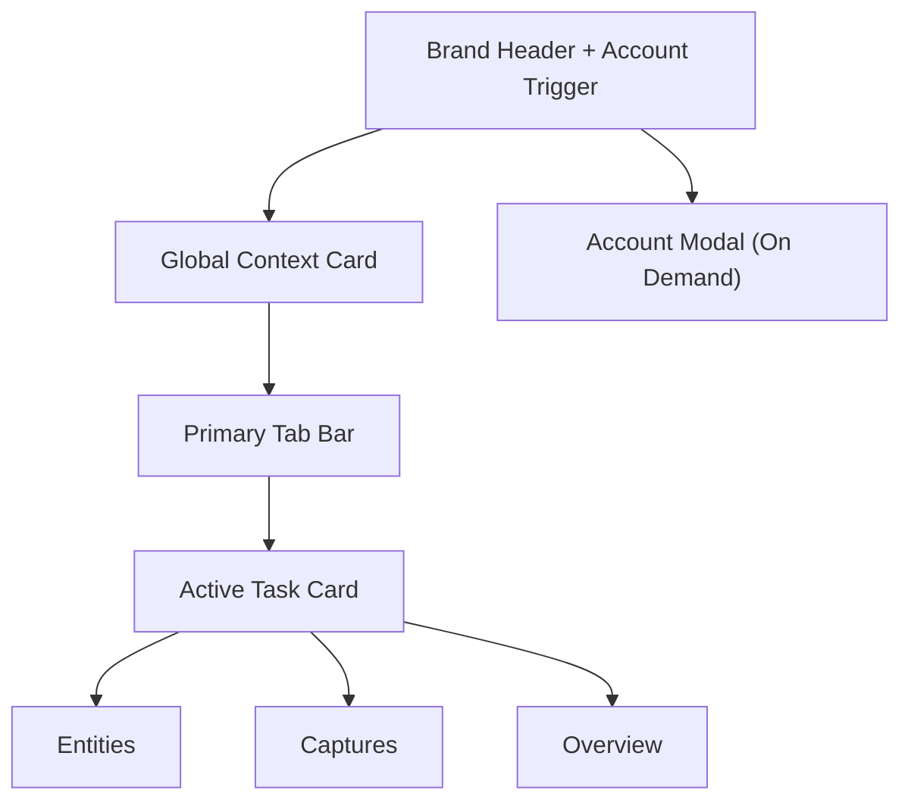

# UI Design Spec: World-Link Alpha

## 1. Design Positioning

## 1.1 产品气质

World-Link Alpha 的视觉定位不是“展示型创意页面”，而是：

- 极简
- 现代
- 工具化
- 偏 B 端效率
- 有轻微科技感，但不靠重装饰

当前更适合采用 **Trust & Authority + White Card Efficiency** 的设计方向：

- 白底 / 浅灰底
- 明确边界
- 稳定卡片层次
- 微弱但精致的动效
- 高信息密度但不拥挤

## 1.2 适用场景

- 浏览器 Sidepanel
- 宽度波动大，通常在 `320px–520px`
- 用户会高频打开 / 关闭
- 以列表、表单、筛选、快捷操作为主

## 1.3 当前视觉判断

- Sidepanel 已经偏向正确方向：
  - 白底
  - 卡片化
  - 中等信息密度
- 但还需要继续补齐：
  - 卡片间距统一
  - 横向滚动绝对禁止
  - 字体与视觉层级再统一
  - 网页采集弹窗与 Sidepanel 的品牌语言统一

---

## 2. 页面结构设计

## 2.1 Sidepanel 整体布局

从上到下只保留四个稳定层：

1. **Brand Header（含右上角账户入口）**
2. **Global Context Card**
3. **Primary Tab Bar**
4. **Active Task Card**

账号与同步信息改为**按需弹窗层**，不占用默认首屏高度。

### 页面结构图



## 2.2 每个区域的作用

### Brand Header
- 负责品牌识别与产品定位
- 右上角提供账户入口（用户名 / 套餐 / 登录状态）
- 账户入口点击后打开账号与同步弹窗
- Header 采用紧凑工具栏样式（单行主标题 + 单行副标题），禁止多行大标题占用首屏

### Global Context Card
- 设置 `世界 / 书项目`
- 是所有任务的上文，不属于任一 Tab

### Primary Tab Bar
- 一级任务切换
- 控制当前“正在做什么”

### Active Task Card
- 当前真实工作区
- 当前只切换 `实体 / 捕获 / 概览`

## 2.3 信息流设计

用户在 Sidepanel 的标准操作路径应为：

1. 先确认上下文（世界 / 书）
2. 再切换任务（实体 / 捕获 / 概览）
3. 最后在当前任务区完成搜索 / 整理 / 编辑

也就是：

```text
Context First → Task Second → Action Third
```

---

## 3. 组件体系划分

## 3.1 核心组件列表

### Shell 级组件
- `BrandHeader`
- `AccountTrigger`
- `AccountModal`
- `GlobalContextCard`
- `PrimaryTabBar`
- `TaskCard`

### 业务组件
- `EntityToolbar`
- `EntityCard`
- `EntityEditor`
- `EntityTagEditor`
- `CaptureCard`
- `MetricsCard`
- `SummaryCard`

### 基础组件
- `Button`
- `IconButton`
- `InlineButton`
- `Input`
- `Textarea`
- `Select`
- `Tag`
- `EmptyState`
- `HelperText`
- `InlineMessage`
- `ActionDialog`

## 3.2 各组件职责

### `BrandHeader`
- 展示品牌标识、产品名、简短说明

### `GlobalContextCard`
- 负责世界与书项目的选择
- 字段级操作包括 `+ 新世界`、`+ 新书`

### `PrimaryTabBar`
- 负责一级任务切换
- `捕获` 可显示数量徽标

### `EntityToolbar`
- 承担搜索、类型过滤、后续标签过滤与导出入口

### `EntityCard`
- 展示实体摘要
- 是列表视图中的最小业务单元

### `EntityEditor`
- 展示当前实体的结构化表单
- 承担编辑和保存动作

### `CaptureCard`
- 承担历史捕获展示、状态流转与“转实体”动作

### `MetricsCard`
- 用于概览中的轻量统计

## 3.3 组合关系

```text
Sidepanel Shell
├── BrandHeader
├── GlobalContextCard
├── PrimaryTabBar
└── TaskCard
    ├── EntityToolbar + EntityCard + EntityEditor
    ├── CaptureCard list
    └── MetricsCard + SummaryCard
```

## 3.4 高复用组件

优先抽象以下高复用基础组件：

- `Button`
- `Input`
- `Select`
- `Tag`
- `EmptyState`
- `CardHeader`
- `HelperText`

---

## 4. 视觉设计规范

## 4.1 Color Tokens

| Token | Value | Usage |
|---|---|---|
| `--bg-page` | `#F8FAFC` | 页面背景 |
| `--bg-card` | `#FFFFFF` | 卡片背景 |
| `--bg-soft` | `#F1F5F9` | 浅分区 / hover |
| `--text-primary` | `#0F172A` | 主文本 |
| `--text-secondary` | `#64748B` | 辅助文本 |
| `--border-default` | `#E2E8F0` | 默认边框 |
| `--primary` | `#2563EB` | 主操作色 |
| `--primary-soft` | `#EFF6FF` | 主操作浅底 |
| `--primary-hover` | `#1D4ED8` | 主操作 hover |
| `--success` | `#10B981` | 成功态 |
| `--warning` | `#F59E0B` | 提醒态 |
| `--danger` | `#EF4444` | 错误态 |

## 4.2 配色原则

- 页面背景不用纯白，而用冷灰白
- 卡片用纯白建立稳定层次
- 主色只用于：
  - 主按钮
  - 当前态 Tab
  - 重点链接
- 不使用大面积高饱和渐变
- 不引入 AI 感紫粉色渐变

## 4.3 Typography

### 推荐字体策略
- **Target**：`Plus Jakarta Sans`
- **Fallback**：`Inter, system-ui, sans-serif`

> 当前代码里使用的是 `Inter` 风格系统字体，后续可平滑升级到 `Plus Jakarta Sans`，不影响信息架构。

### 字号层级

| Level | Size / Line Height | Weight | Usage |
|---|---|---|---|
| Display | `22 / 28` | `600` | 品牌标题 |
| H2 | `16 / 24` | `600` | 卡片标题 |
| Body | `14 / 22` | `400` | 正文 |
| Meta | `12 / 18` | `400` | 标签 / 时间 / 辅助信息 |
| Button | `13 / 20` | `500~600` | 操作按钮 |

## 4.4 间距系统

采用固定四档体系，不再扩散：

- `8px`
- `12px`
- `16px`
- `20px`

### 页面外边距
- `320–359px`：`12px`
- `360–520px`：`16px`
- `521px+`：`20px`

### 常用间距
- 模块间距：`12px`
- 卡片内边距：`16px`
- 表单项间距：`12px`
- 列表项间距：`8px`
- 标题与正文：`16px`

## 4.5 圆角 / 阴影 / 边框

### 圆角
- 品牌区：`16px`
- 卡片：`12px`
- 输入框 / 按钮 / tab：`8px ~ 10px`
- tag / badge：`999px`

### 阴影
- 默认卡片：`0 1px 2px rgba(15,23,42,0.06)`
- Hover 卡片：`0 4px 12px rgba(15,23,42,0.10)`

### 边框
- 默认统一使用 `1px solid var(--border-default)`
- Active 态才允许替换为主色边框

## 4.6 动效规范

### Hover
- 只改变颜色、阴影、边框
- 不做 `scale`，避免布局跳动

### Duration
- 标准过渡：`120ms–180ms`

### Timing
- `ease-out` 或 `ease-in-out`

### Loading
- 用骨架或按钮 loading
- 不使用大面积闪烁动画

---

## 5. 交互设计原则

## 5.1 Hover / Active / Disabled

### Hover
- 背景轻微提亮
- 边框加深
- 鼠标指针明确变化

### Active
- 使用主色浅底 + 主色边框
- 避免强烈阴影

### Disabled
- 降低透明度
- 保留布局占位
- 禁止“直接消失”
- Pro 专属操作（如 JSON 导出）在 Free 下保持可见但禁用，并提供说明文案

## 5.2 点击反馈逻辑

- 按钮点击后必须在 `100ms` 内给出视觉反馈
- 保存类操作要么进入 loading，要么立即 toast / error
- 切换 Tab 时不允许丢失世界 / 书上下文

## 5.3 Loading / Empty / Error

### Loading
- 优先使用局部 loading
- 不阻塞整个 Sidepanel

### Empty
- 空状态必须给出下一步动作建议
- 例如：
  - “请先选择或创建一个世界”
  - “当前世界尚无实体，可先从捕获整理”

### Error
- 表单错误就近展示
- 全局错误可配合轻量 toast

## 5.4 如何减少用户操作成本

1. 上下文常驻，避免重复选择世界 / 书
2. 高频任务默认落到 `实体`
3. 从捕获转实体时自动跳转并预填
4. 把 `新世界 / 新书` 放在字段级，不额外开一列按钮区

## 5.5 Accessibility Baseline（新增）

### 对比度要求
- 正文与背景对比度不低于 `4.5:1`
- 大号文本（`>=18px` 或粗体 `>=14px`）不低于 `3:1`
- 关键状态色（成功/警告/错误）不可仅靠颜色区分，需配合图标或文案

### 键盘可达与焦点可见
- 所有可交互控件必须可通过 `Tab` 到达
- 焦点态必须有明确可见的 outline 或边框增强（不低于 `2px` 可见边界）
- 弹窗打开后焦点应落在首个可操作控件，关闭后返回触发源

### Disabled / 错误态可辨识
- Disabled 控件除降透明度外，需保留禁用语义（`aria-disabled` 或原生 `disabled`）
- 表单错误需就近展示错误文本，不只改变边框颜色
- 门禁型禁用（如 Pro 功能）必须附带可读原因与升级引导

---

## 6. 风格关键词

用于统一设计判断的关键词：

- Minimal
- Clean Hierarchy
- White Card
- Soft Contrast
- Trustworthy
- Efficient
- Structured
- Calm Motion
- Compact Spaciousness
- Stable Interaction
- Utility-first
- Focused
- Single-column-first
- Scalable Shell
- Quiet Confidence

---

## 7. 响应式与自适应策略

## 7.1 总原则

World-Link Alpha 不是“只为 320–400px 设计”，而是：

- **以窄侧边栏为基线**
- **对更宽空间做局部增强**
- **全局绝不出现横向滚动**

## 7.2 Width Modes

### Compact：320–400px
- 整体单列
- 工具栏换行
- 列表与编辑区上下堆叠

### Standard：401–520px
- 仍是单列主结构
- 工具栏可恢复同行
- 概览指标恢复两列

### Expanded：521px+
- Shell 仍是单主列
- 任务区内部允许局部双栏
- 典型场景：`Entity List + Entity Editor`

## 7.3 Overflow Checklist

- 所有卡片设置 `width: 100%` / `max-width: 100%`
- 所有输入框 `min-width: 0`
- 所有 flex 容器默认考虑 `wrap`
- 导出按钮组在 `<=420px` 自动换行，不允许把容器撑出侧边栏
- 长链接 / 长文本必须截断或换行
- 不允许固定宽按钮把表单挤出边界

---

## 8. 当前项目的具体 UI 约束

## 8.1 必须修好的细节

- 不出现横向滚动条
- 卡片间距统一为同一套 rhythm
- 列表卡片间距固定为 `10px`，模块间距固定为 `14px`
- 字段级操作不再孤立成一整列
- 标签数量克制，单卡不超过 3 个主要标签
- 卡片摘要控制在 2 行左右

## 8.2 当前不建议继续保留的视觉问题

- Emoji 作为长期正式图标
- 过深阴影
- 高饱和大渐变
- 只有视觉切换、没有任务意义的 tab
- 把所有内容堆进一张超长卡片

## 8.3 Sidepanel 与网页采集弹窗的统一策略

当前实现已经统一为白底卡片效率风，后续保持以下约束：

1. 交互结构保持不变，避免视觉升级引发学习成本
2. Sidepanel 与采集弹窗共用同一套控件层级
3. 保持：
   - 相同的按钮层级
   - 相同的输入框样式逻辑
   - 相同的间距节奏

---

## 9. 前端实现建议

## 9.1 当前项目方向

项目当前是 React + Tailwind layer + CSS Variables 组合：

- `sidepanel/src/index.css` 已经承担 token 与基础布局规则
- 这条路适合继续走

## 9.2 推荐实现策略

### CSS Variables
- 用于：
  - 色彩 token
  - 圆角
  - 阴影
  - 字体层级

### Tailwind / utility class
- 用于：
  - 快速布局
  - 间距
  - 对齐
  - 响应式微调

### 组件拆分
- 保持：
  - Shell 组件
  - Context 组件
  - Tab 组件
  - 任务区组件
  - 基础表单组件

## 9.3 Theme Strategy

当前项目主方向建议是：

- Sidepanel 默认优先做 **Light-first**
- 未来若需要 dark mode，再通过 CSS Variables 切主题

原因：
- 当前产品更偏 B 端效率工具
- 白底卡片在 Sidepanel 中更利于高频扫读

## 9.4 动效实现建议

- 首选 CSS transition
- 只在必要处使用 JS 控制：
  - 高亮回放
  - Toast 生命周期
  - 局部展开收起

---

## 10. Code Mapping

### 当前文件映射
- `sidepanel/src/App.jsx`
- `sidepanel/src/components/PrimaryTabBar.jsx`
- `sidepanel/src/components/WorldBookSection.jsx`
- `sidepanel/src/components/EntitySection.jsx`
- `sidepanel/src/components/CaptureSection.jsx`
- `sidepanel/src/components/WorldSummaryCard.jsx`
- `sidepanel/src/index.css`

### 设计职责映射
- `App.jsx`：信息架构与壳层
- `WorldBookSection.jsx`：全局上下文体验
- `PrimaryTabBar.jsx`：一级任务切换
- `EntitySection.jsx`：核心生产力体验
- `CaptureSection.jsx`：素材收件箱体验
- `WorldSummaryCard.jsx`：摘要表达
- `index.css`：design token 与基础样式系统
