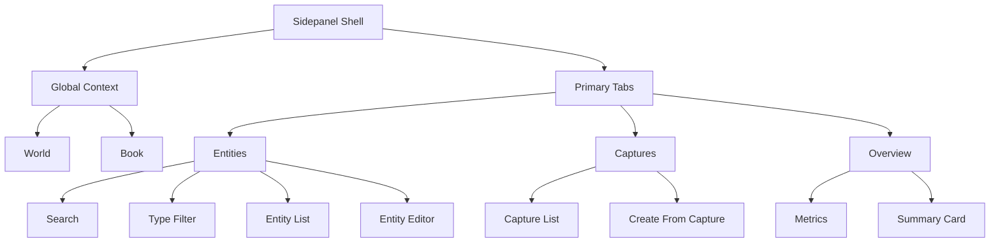

# UX Spec: World-Link Alpha

## Overview

World-Link Alpha 是一个 **双入口、单资产模型** 的浏览器插件产品：

- 网页内容层负责即时采集
- Sidepanel 负责持续管理
- `World / Book / Entity / CapturedItem / BookEntityUsage` 构成统一资产骨架

本 UX Spec 以当前项目真实实现为基础，聚焦当前可执行逻辑与下一阶段扩展路径。

> 对外术语统一：`世界观库`（World）、`当前作品`（Book）、`设定`（Entity）、`灵感记录`（CapturedItem）。

---

## 1. Information Architecture

### 1.1 Product Structure

```text
Chrome Extension: World-Link Alpha
├── Web Content Layer
│   ├── Right-click menu: 存入 World-Link
│   ├── Capture modal
│   └── Success toast
└── Sidepanel
    ├── Brand header + Account trigger
    ├── Account modal (on demand)
    ├── Global context
    │   ├── 世界观库选择器
    │   └── 当前作品选择器
    ├── Primary tabs
    │   ├── 设定库
    │   ├── 灵感箱
    │   └── 总览
    └── Active task area
        ├── 设定库: 搜索 / 过滤 / 列表 / 编辑
        ├── 灵感箱: 记录 / 回填设定
        └── 总览: 指标 / 摘要
```

### 1.2 IA Decisions

1. `世界观库 / 当前作品` 是全局上下文，必须跨 Tab 常驻
2. `设定库 / 灵感箱 / 总览` 是一级任务切换
3. `设定库` 是默认落点
4. `灵感箱` 是素材收件箱，不是首页主内容
5. `总览` 是低频页，承接摘要与未来图谱入口

### 1.3 Information Structure Diagram



---

## 2. Key User Paths

1. **网页即时采集**
   - 网页选中文字 → 右键 → 打开采集弹窗 → 填写结构化信息 → 保存

2. **Sidepanel 中查找与维护设定**
   - 打开 Sidepanel → 选择世界观库 / 当前作品 → 设定库 Tab 搜索 / 过滤 / 编辑

3. **从灵感记录二次整理**
   - 打开 Sidepanel → 灵感箱 Tab → 选择记录 → 回填设定 → 保存

4. **查看当前上下文总览**
   - 打开 Sidepanel → 选择世界观库 / 当前作品 → 切到总览 Tab → 查看摘要

---

## 3. User Flows

### Flow 1: 网页内采集并创建设定

**Trigger**
- 用户在网页中选中一段文本，并通过右键菜单发起采集

**User Goal**
- 在不离开当前网页的前提下，把选中文本快速转成世界资产

```text
[网页选中文本]
    ↓
[右键菜单: 存入 World-Link]
    ↓
[打开采集弹窗]
    ↓
[选择世界观库 / 类型 / 名称 / 当前作品]
    ↓
[点击保存]
    ↓
[设定创建 + 作品绑定 + 灵感记录写入 + Toast]
```

**Error Paths**
- 未选择世界：阻止保存并提示
- 名称为空：阻止保存并提示
- 写入失败：保留表单，不关闭弹窗

**UX Notes**
- 表单必须先可编辑，再考虑 AI 或默认建议
- 不允许为了“智能建议”阻塞保存主路径

---

### Flow 2: Sidepanel 中管理设定

**Trigger**
- 用户需要查找、编辑或新建设定

**User Goal**
- 快速定位当前世界或本书范围内的目标设定

```text
[打开 Sidepanel]
    ↓
[选择世界]
    ↓
[可选选择当前作品]
    ↓
[进入设定 Tab]
    ↓
[搜索 / 类型过滤]
    ↓
[点击设定卡片]
    ↓
[在编辑区修改并保存]
```

**UX Requirements**
- 世界未选择时，要引导“先选世界”，而不是只显示空白列表
- 选中当前作品后，要明确告诉用户当前是“本书视图”
- 编辑区和当前选中设定必须强绑定，不允许出现错位编辑
- 导出默认基于“当前筛选结果”，避免导出与用户视图不一致

---

### Flow 3: 从灵感记录回填设定

**Trigger**
- 用户想把历史采集记录整理成设定

**User Goal**
- 少录一遍，把灵感记录转成结构化资产

```text
[打开 Sidepanel]
    ↓
[切换到灵感 Tab]
    ↓
[浏览灵感记录]
    ↓
[点击 从此创建设定]
    ↓
[自动切换到设定 Tab]
    ↓
[预填编辑表单]
    ↓
[补充信息并保存]
```

**UX Requirements**
- Tab 切换后上下文不得丢失
- 预填字段至少包括：
  - 名称
  - summary
  - sourceUrl / sourceTitle

---

### Flow 4: 查看总览页

**Trigger**
- 用户需要确认当前世界 / 当前作品的整体状态

**User Goal**
- 快速理解，而不是进入重度编辑

```text
[打开 Sidepanel]
    ↓
[选择世界 / 书]
    ↓
[切换到总览 Tab]
    ↓
[查看指标卡]
    ↓
[查看世界摘要]
```

**UX Requirements**
- `总览` 只承载摘要，不承载复杂编辑
- 卡片必须可扫读，避免把它做成第二个管理页
- 总览统计以“当前世界 / 当前书上下文”为准，不受搜索词干扰

---

## 4. Screen Inventory

### Screen A: Web Capture Modal

**Purpose**
- 在当前网页完成一次结构化采集

**Entry**
- 用户在网页中选中文字后点击右键菜单

**Core Sections**
- 选中文本预览
- 来源信息
- 世界选择
- 类型选择
- 名称输入
- 所属当前作品
- 描述输入
- 标签输入
- 保存 / 取消

**States**
- Default
- Validation Error
- Saving
- Success
- Failure

**UX Rules**
- 弹窗居中显示即可，不需要跟随鼠标位置
- 选中文本预览可截断，但不能完全不可见
- 世界与名称是强校验字段

---

### Screen B: Sidepanel Shell

**Purpose**
- 提供稳定、低认知负担的持续管理工作区

**Layout**
```text
┌───────────────────────────────┐
│ Brand Header + Account Trigger│
├───────────────────────────────┤
│ Global Context                │
│ World / Book                  │
├───────────────────────────────┤
│ Primary Tabs                  │
├───────────────────────────────┤
│ Active Task Area              │
│ 设定 / 灵感 / 总览            │
└───────────────────────────────┘
```

**Shell Principles**
- 顶层结构稳定
- 切换 Tab 时，世界 / 书上下文不丢
- 所有任务都在同一个壳层内完成，不重复导航
- 账号会话与同步配置改为“右上角入口 + 弹窗按需查看”，首屏不抢占工作区
- 账号登录后自动进入云端同步状态，不向用户暴露技术模式切换
- 提供配额提示与“本机数据迁移到云端”操作入口
- 云端失败时提供可复制的 traceId 提示，降低联调成本

---

### Screen B1: Account Modal（账号与同步弹窗）

**Trigger**
- 点击 Header 右上角用户名/账号入口

**Purpose**
- 在不打断主工作流的前提下，承载登录、套餐、同步配置与迁移操作

**Core Components**
- 账号状态（邮箱 / 套餐）
- 配额摘要（灵感 / Markdown 导出）
- 操作按钮（登录、退出、升级、刷新套餐、迁移本机数据）

**UX Rules**
- 弹窗为按需打开，不在首屏常驻
- 点击遮罩或关闭按钮可退出弹窗
- 弹窗内所有反馈通过应用内消息条展示，不使用浏览器原生弹窗

---

### Screen C: 设定 Tab

**Purpose**
- 设定查找、过滤、编辑，是当前最高频工作区

**Core Components**
- 新建设定按钮
- 搜索框
- 类型筛选
- 标签筛选
- 设定列表
- 设定编辑区

**States**
- 未选择世界
- 空列表
- 搜索无结果
- 正常列表
- 编辑中

**Behavior Notes**
- 窄宽度下列表和编辑区上下堆叠
- 宽度变大后允许局部双栏，但仍保持单页单任务
- 标签编辑采用 chip 交互（可删、可追加、可用常用标签快捷添加）

---

### Screen D: 灵感 Tab

**Purpose**
- 承接灵感记录浏览与二次整理

**Core Components**
- 状态筛选（全部 / 未整理 / 已整理 / 已转设定）
- 来源筛选
- 时间筛选
- 灵感记录列表
- 来源信息
- 时间信息
- 热度标记
- 状态标记与状态切换按钮
- “从此创建设定”按钮

**States**
- 空灵感
- 有记录
- 最近更新高亮
- 状态流转（未整理 -> 已整理 -> 已转设定）

**Behavior Notes**
- 灵感卡优先展示文本，其次是来源和时间
- 操作按钮是整理动作，不应该抢正文信息
- 过滤条件切换后，列表应即时更新且不丢失当前上下文

---

### Screen E: 总览 Tab

**Purpose**
- 提供当前上下文下的摘要信息

**Core Components**
- 指标卡片
- 世界摘要
- 未来扩展挂载位

**States**
- 未选择世界
- 已选择世界但暂无摘要
- 正常摘要

---

## 5. Component Model

### `PrimaryTabBar`

**Purpose**
- 一级任务切换

**Rules**
- 固定 3 个 tab
- 标签必须短
- 当前态与默认态对比清晰
- `灵感` 可带数量徽标

### `WorldBookSection`

**Purpose**
- 作为全局上下文控制器

**Rules**
- 必须跨 Tab 常驻
- `新世界 / 新书` 是字段级操作，不是主 CTA
- 宽度不足时允许换行

### `EntitySection`

**Purpose**
- 当前生产力核心工作区

**Rules**
- 搜索优先级高于其他筛选
- 列表和编辑区关系必须紧密
- 宽度变大后允许列表 + 编辑区双栏
- 标签编辑器支持建议补全，减少重复录入

### `CaptureSection`

**Purpose**
- 承接素材收件箱与二次整理

**Rules**
- 卡片层级为：文本 > 来源 > 时间/热度 > 操作
- 高亮只能作为短时反馈，不能长期打断浏览

### `WorldSummaryCard`

**Purpose**
- 承接低频摘要信息

**Rules**
- 不承担复杂操作
- 指标卡必须可快速扫读

---

## 6. Interaction Specifications

### Interaction 1: 打开采集弹窗

**Trigger**
- 用户右键点击 `存入 World-Link`

**Response**
- 网页中央打开采集弹窗
- 自动带入选中文本、来源信息、世界/书上下文候选

**Feedback**
- 立即出现，不等待异步推理

### Interaction 2: 保存设定

**Trigger**
- 用户点击保存

**Response**
- 表单字段校验
- 成功则关闭弹窗并显示成功提示
- 失败则保留当前表单并提示错误

**Latency Expectation**
- 页面级交互应给出即时反馈
- 若写入较慢，也不能让按钮无反馈

### Interaction 3: 切换本书视图

**Trigger**
- 用户在全局上下文中选择某个当前作品

**Response**
- 设定列表切换到仅显示本书使用设定
- 当前编辑设定上下文清空，避免误编辑

### Interaction 4: 从灵感转设定

**Trigger**
- 用户点击“从此创建设定”

**Response**
- 自动切到设定 Tab
- 预填表单
- 保持当前世界 / 书上下文

---

## 7. Responsive Behavior

### 7.1 Responsive Strategy

World-Link Alpha 不采用“固定 320–400px 设计思维”，而是采用：

- **单列优先**
- **全局自适应**
- **局部增强**

即：整体壳层始终以单列为主，但随着宽度增加，局部区域可以增强为双栏。

### 7.2 Width Modes

**Compact：320–400px**
- 壳层单列
- 工具栏与按钮允许换行
- 设定列表与编辑区上下堆叠

**Standard：401–520px**
- 壳层仍为单列
- 工具栏可恢复同行布局
- 总览指标可恢复 2 列

**Expanded：521px+**
- 壳层仍维持单主列
- 当前任务区内部允许双栏
- 典型场景：设定列表 + 编辑区

### 7.3 Overflow Rules

- 所有主容器必须 `width: 100%` 且 `max-width: 100%`
- 所有表单控件必须允许收缩
- 工具栏默认支持 `wrap`
- 长文本优先截断或换行，不能逼出横向滚动

---

## 8. Current UX Gaps

### Gap 1: 图谱能力未接入
- 目前只支持设定清单与筛选
- 关系边与世界图谱仍是下一阶段能力

### Gap 2: 书稿解析未接入
- 当前当前作品视图依赖人工标记 `BookEntityUsage`
- 还没有正文自动识别与回填流程

### Gap 3: 总览深度仍可增强
- 已支持实时指标与最近动态
- 后续可增加趋势、按类型占比变化与异常提醒

---

## 9. Code Alignment

### Current Structure
- `sidepanel/src/App.jsx`
- `sidepanel/src/components/WorldBookSection.jsx`
- `sidepanel/src/components/PrimaryTabBar.jsx`
- `sidepanel/src/components/EntitySection.jsx`
- `sidepanel/src/components/CaptureSection.jsx`
- `sidepanel/src/components/WorldSummaryCard.jsx`
- `background.js`
- `content.js`
- `sidepanel/src/index.css`

### Implementation Summary
- IA 与组件边界已经初步形成
- 代码结构已支持继续迭代
- 下一阶段重点是：
  - 完善标签 / 导出 / 总览
  - 清理旧协议
  - 统一视觉与交互语言
