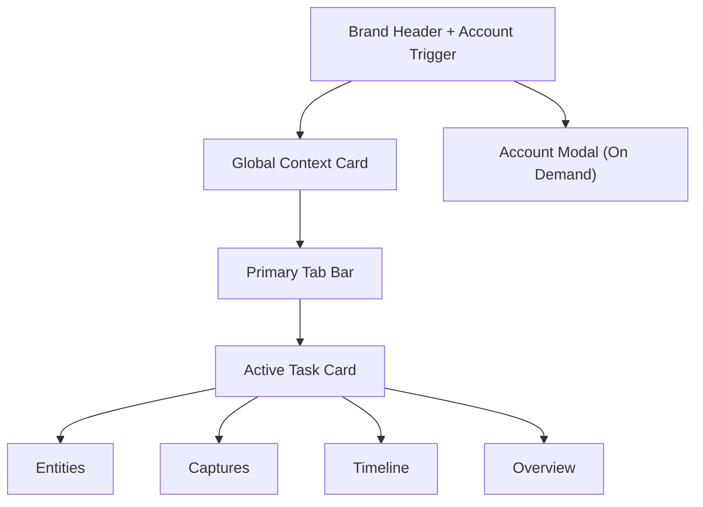

# UI Design Spec: World-Link Alpha

- Design Source: StyleKit 风格库 + World-Link 产品约束
- Design Version: v1.26
- Last Synced: 2026-04-21

> 风格决策基线见：`docs/design/style-decision-v1.md`  
> 执行清单见：`docs/design/style-execution-checklist-v1.md`  
> 代码 token 文件：`sidepanel/src/styles/stylekit-theme-v1.css`

## 1. Design Positioning

## 1.1 产品气质

World-Link Alpha 的视觉定位不是“展示型创意页面”，而是：

- 极简
- 现代
- 工具化
- 偏 B 端效率
- 有轻微科技感，但不靠重装饰

当前更适合采用 **Trust & Authority + White Card Efficiency** 的设计方向：

- 白底 / 浅灰底
- 明确边界
- 稳定卡片层次
- 微弱但精致的动效
- 高信息密度但不拥挤

风格执行上统一采用：

- `Corporate Clean` 作为主工作区底盘
- `Notion-style` 只用于说明文本、空状态与帮助块的可读性增强
- `Stripe-style` 仅限未来营销域，不进入 Sidepanel 主流程

## 1.2 适用场景

- 浏览器 Sidepanel
- 宽度波动大，通常在 `320px–520px`
- 用户会高频打开 / 关闭
- 以列表、表单、筛选、快捷操作为主

因此必须遵守 `Sidepanel First`：

- 先保证 `320–400px` 的可读性与操作效率
- 再在更宽空间里做局部层级增强
- 不把当前产品做成“缩小版后台”

## 1.3 当前视觉判断

- Sidepanel 已经偏向正确方向：
  - 白底
  - 卡片化
  - 中等信息密度
- 但还需要继续补齐：
  - 卡片间距统一
  - 横向滚动绝对禁止
  - 字体与视觉层级再统一
  - 网页采集弹窗与 Sidepanel 的品牌语言统一
  - Loading / Empty / Error 与主风格完全对齐

## 1.4 术语清晰化（文案约束）

- 对外统一使用：
  - `世界观库`（替代“世界”）
  - `当前作品`（替代“书项目”）
  - `设定 / 设定卡`（替代“实体”）
  - `灵感记录 / 灵感箱`（替代“捕获”）
- 技术文档允许保留 `Entity`，但 UI 文案不直接暴露技术词。

---

## 2. 页面结构设计

## 2.1 Sidepanel 整体布局

从上到下只保留四个稳定层：

1. **Brand Header（含右上角账户入口）**
2. **Global Context Card**
3. **Primary Tab Bar**
4. **Active Task Card**

账号与同步信息改为**按需弹窗层**，不占用默认首屏高度。

### 页面结构图



## 2.2 每个区域的作用

### Brand Header
- 负责品牌识别与产品定位
- 右上角提供账户入口（用户名 / 套餐 / 登录状态）
- 账户入口点击后打开账号与同步弹窗
- Header 采用紧凑工具栏样式（单行主标题 + 单行副标题），禁止多行大标题占用首屏
- 未登录时账户状态使用 `访客`，不再使用会误导能力预期的“本地”
- 访客首屏隐藏刷新按钮，避免在尚未进入工作区时暴露无意义系统动作
- Header 副标题不再复述 `当前范围`；上下文解释统一交给 `Global Context Card`
- 访客首屏采用更轻的 Header 变体：更短副标题、更弱阴影、更扁平账户入口
- 访客账户入口优先使用单行紧凑状态，不再在 Header 内堆叠第二张“大卡片”
- 访客 Header 应优先收敛为单行工具条，避免品牌区和状态区形成上下双层
- 访客状态入口文案收敛为 `访客 / 登录同步`，避免重复出现未登录、未同步、去登录等多组近义词

### Global Context Card
- 设置 `世界观库 / 当前作品`
- 是所有任务的上文，不属于任一 Tab
- 仅在用户进入正常工作区后显示；访客首屏由开始使用引导卡替代

### Primary Tab Bar
- 一级任务切换
- 控制当前“正在做什么”

### Active Task Card
- 当前真实工作区
- 当前切换 `设定库 / 灵感箱 / 时间轴 / 总览`
- `总览` 优先呈现“跨世界快览 → 当前世界摘要 → 关系图谱 → 最近动态入口”
- `时间轴` 作为独立一级任务承接完整事件浏览，避免总览页继续膨胀

## 2.3 信息流设计

用户在 Sidepanel 的标准操作路径应为：

1. 先确认上下文（世界观库 / 当前作品）
2. 再切换任务（设定库 / 灵感箱 / 时间轴 / 总览）
3. 最后在当前任务区完成搜索 / 整理 / 编辑

也就是：

```text
Context First → Task Second → Action Third
```

## 2.4 首屏状态优先级

Sidepanel 首屏必须按以下顺序判断状态，禁止把不同性质的状态混成同一个红色报错：

1. `首次加载中`
   - 仅在“还没有任何工作区数据”时显示全局 loading
2. `未登录`
   - 进入 `开始使用` 引导态
   - 展示 `登录账号 / 注册账号`
   - 不展示页面级错误态
   - 不展示访客当前无法操作的世界/作品选择区
3. `已登录但无数据`
   - 正常进入工作区
   - 由 `当前范围` 承接创建首个世界观库的空状态
4. `真实请求失败`
   - 无存量数据时显示阻断型错误卡
   - 有存量数据时优先保留当前工作区，仅在顶部提示刷新失败

状态语义必须严格区分：

- `未登录 = 引导态`
- `无数据 = 空态`
- `请求异常 = 错误态`

---

## 3. 组件体系划分

## 3.1 核心组件列表

### Shell 级组件
- `BrandHeader`
- `AccountTrigger`
- `AccountModal`
- `GlobalContextCard`
- `PrimaryTabBar`
- `TaskCard`

### 业务组件
- `EntityToolbar`
- `EntityCard`
- `EntityEditor`
- `EntityTagEditor`
- `EntityRelationEditor`
- `RelationGraphPreviewCard`
- `CaptureCard`
- `MetricsCard`
- `SummaryCard`
- `CrossWorldQuickList`

### 基础组件
- `Button`
- `IconButton`
- `InlineButton`
- `Input`
- `Textarea`
- `Select`
- `Tag`
- `EmptyState`
- `HelperText`
- `InlineMessage`
- `ActionDialog`

## 3.2 各组件职责

### `BrandHeader`
- 展示品牌标识、产品名、简短说明
- 必须保持紧凑工具栏感，而不是演化成品牌横幅

### `AccountModal`
- 操作区分为两层：系统动作（刷新套餐/迁移）与账号动作（登录/升级/退出）
- 在 `<=420px` 自动收敛为单列按钮布局，避免横向挤压
- 由账号弹窗触发的反馈必须优先显示在弹窗内部，不把成功/失败提示抛到主面板顶部
- 退出登录成功后应关闭弹窗，并直接回到未登录引导态
- 访客态账号弹窗只保留身份说明与 `登录 / 注册` 入口，不展示配额摘要与刷新权益动作
- 从访客态账号弹窗进入 `登录 / 注册` 时，应先关闭当前弹窗，再打开表单弹窗，避免双层弹窗叠加
- 登录过期或会话失效时，不应强制弹出账号弹窗；优先用非阻断提示引导重新登录
- 若账号弹窗此时已经打开，过期提示应直接落在弹窗内部，并同步收正访客状态
- 套餐到期与权限不足的恢复动作统一落到账号面板处理，不再让用户自己猜下一步入口

### `ActionDialog`
- 承接登录、注册与轻量创建流程的表单输入
- 校验错误、提交失败与必填提示必须显示在弹窗内部，不允许把反馈渲染到背后的主工作区
- 当 `ActionDialog` 打开时，主面板顶部的全局 `InlineMessage` 应暂时隐藏，避免前后景反馈混叠
- 当表单来自访客账号弹窗时，应视为“继续当前登录流程”，而不是新增一层上下文
- 如果创建世界 / 作品被套餐上限拦截，弹窗内提示必须明确说明原因，并提供去账号面板处理的下一步

### `GlobalContextCard`
- 负责世界观库与当前作品的选择
- 字段级操作包括 `+ 新建世界观`、`+ 新建作品`
- 不承担“未登录”提示；未登录提示必须在它之前完成分流

### `PrimaryTabBar`
- 负责一级任务切换
- `灵感箱` 可显示数量徽标
- `时间轴` 是独立一级页，不再作为总览里的完整内容块
- 支持轻量图标与 `99+` 徽标收敛，保证窄栏可读性
- active 态优先表达“当前工作模式”，而不是装饰性高亮

### `EntityToolbar`
- 承担搜索、类型过滤、后续标签过滤与导出入口

### `EntityCard`
- 展示设定摘要
- 是列表视图中的最小业务单元

### `EmptyStateCard`
- 统一空状态视觉（图标徽记 + 标题 + 描述 + CTA）
- 适用于设定页与灵感页的无数据/无结果场景
- 支持 `compact` 形态用于概览/图谱区，兼顾信息密度与层级一致性
- 说明区允许借用 `Notion-style` 的文本节奏，但 CTA 仍保持工具型清晰结构
- 访客首屏不再直接复用通用 `EmptyState` 结构，而是使用单主卡 onboarding 版式：标题、简述、收益块、主 CTA 一次表达完成
- 访客 onboarding 采用 `Compact Workspace`：双按钮并列 CTA + 一个微型工作区预览块，优先展示登录后的产品结构，而不是并列功能卡片
- 微型工作区预览只允许使用固定示意文案，例如 `世界观库 / 示例世界观`、`当前作品 / 示例作品`、`设定与灵感 / 角色 · 地点 · 片段`

### `EntityEditor`
- 展示当前设定的结构化表单
- 承担编辑、关系维护和保存动作
- 已支持 AI 总结 / 扩写按钮（Pro 门禁）
- 已支持 AI 文案策略选择（风格：简洁/平衡/详细；长度：短/中/长）
- 已支持 AI 查重 / 冲突提醒按钮（Pro 门禁）
- 支持书稿解析候选设定回填
- 支持书稿关系推断结果展示与一键回填（关系草稿 / 直接添加）
- 已支持 AI 来源提示（云端模型 / 本地兜底）与最近操作时间反馈
- 已支持 AI 质量信息显示（质量等级/分数）与模型策略版本展示
- 已支持 AI 结果反馈按钮（结果有帮助/需优化、检测准确/需校准）
- 已支持 AI 兜底友好提示映射（超时 / 网络 / 鉴权 / 限流 / 服务异常）
- 冲突结果支持风险分级标签（高/中/低）与 reasonCode 统一解释文案
- 冲突结果支持风险筛选（全部/高/中/低）与结果计数反馈
- 冲突卡片支持“处理建议”行（基于 reasonCode 模板）帮助用户快速修订
- 冲突区域支持风险分布摘要（高/中/低）与策略版本显示，便于策略联调
- 冲突区域支持阈值快照文案（名称/描述相似度阈值、风险阈值、TopN 返回上限）

### `CaptureCard`
- 承担历史灵感展示、状态流转与“转设定”动作

### `RelationGraphPreviewCard`
- 承担概览页关系预览（关系节点、类型分布、最近关系边）
- 当前已支持交互图谱（缩放 / 拖拽 / 节点高亮）
- 支持世界图谱 / 本书图谱切换
- 当前作品图谱支持独立作品下拉切换（不改全局上下文）
- 已接入力导向布局，减少节点重叠
- 已支持图谱状态提示条（自动轻量、采样上限、分批加载剩余量）
- 焦点态支持一键“清除焦点”回到全图模式

### `MetricsCard`
- 用于概览中的轻量统计

### `TimelineSection`
- 承担独立时间轴 Tab 的事件浏览、筛选与管理
- 总览页只保留“最近动态”摘要，不复制完整时间轴工作流

### `CrossWorldQuickList`
- 承担概览页跨世界快速浏览与跳转
- 展示每个世界的作品数 / 设定数 / 关系数
- 当前世界展示“当前”标签并禁用重复切换按钮

## 3.3 组合关系

```text
Sidepanel Shell
├── BrandHeader
├── GlobalContextCard
├── PrimaryTabBar
└── TaskCard
    ├── EntityToolbar + EntityCard + EntityEditor
    ├── CaptureCard list
    ├── TimelineSection
    └── MetricsCard + SummaryCard
```

## 3.4 高复用组件

优先抽象以下高复用基础组件：

- `Button`
- `Input`
- `Select`
- `Tag`
- `EmptyState`
- `CardHeader`
- `HelperText`

---

## 4. 视觉设计规范

## 4.1 Color Tokens

| Token | Value | Usage |
|---|---|---|
| `--bg-page` | `#F8FAFC` | 页面背景 |
| `--bg-card` | `#FFFFFF` | 卡片背景 |
| `--bg-soft` | `#F1F5F9` | 浅分区 / hover |
| `--text-primary` | `#0F172A` | 主文本 |
| `--text-secondary` | `#64748B` | 辅助文本 |
| `--border-default` | `#E2E8F0` | 默认边框 |
| `--primary` | `#2563EB` | 主操作色 |
| `--primary-soft` | `#EFF6FF` | 主操作浅底 |
| `--primary-hover` | `#1D4ED8` | 主操作 hover |
| `--success` | `#10B981` | 成功态 |
| `--warning` | `#F59E0B` | 提醒态 |
| `--danger` | `#EF4444` | 错误态 |

## 4.2 配色原则

- 页面背景不用纯白，而用冷灰白
- 卡片用纯白建立稳定层次
- 主色只用于：
  - 主按钮
  - 当前态 Tab
  - 重点链接
- 不使用大面积高饱和渐变
- 不引入 AI 感紫粉色渐变
- 工作区禁用重渐变卡片与重投影

## 4.3 Typography

### 推荐字体策略
- **Target**：`Plus Jakarta Sans`
- **Fallback**：`Inter, system-ui, sans-serif`

> 当前代码里使用的是 `Inter` 风格系统字体，后续可平滑升级到 `Plus Jakarta Sans`，不影响信息架构。

### 字号层级

| Level | Size / Line Height | Weight | Usage |
|---|---|---|---|
| Display | `22 / 28` | `600` | 品牌标题 |
| H2 | `16 / 24` | `600` | 卡片标题 |
| Body | `14 / 22` | `400` | 正文 |
| Meta | `12 / 18` | `400` | 标签 / 时间 / 辅助信息 |
| Button | `13 / 20` | `500~600` | 操作按钮 |

## 4.4 间距系统

采用固定四档体系，不再扩散：

- `8px`
- `12px`
- `16px`
- `20px`

### 页面外边距
- `320–359px`：`12px`
- `360–520px`：`16px`
- `521px+`：`20px`

### 常用间距
- 模块间距：`12px`
- 卡片内边距：`16px`
- 表单项间距：`12px`
- 列表项间距：`8px`
- 标题与正文：`16px`
- 概览块（overview-block）之间：`12px`
- 跨世界快览列表项上下内边距：`8px`

## 4.5 圆角 / 阴影 / 边框

### 圆角
- 品牌区：`16px`
- 卡片：`12px`
- 输入框 / 按钮 / tab：`8px ~ 10px`
- tag / badge：`999px`

### 阴影
- 默认卡片：`0 1px 2px rgba(15,23,42,0.06)`
- Hover 卡片：`0 4px 12px rgba(15,23,42,0.10)`
- 禁止 `shadow-xl / shadow-2xl` 级别的厚重阴影进入主工作区

### 边框
- 默认统一使用 `1px solid var(--border-default)`
- Active 态才允许替换为主色边框
- 概览重点块（如图谱区）允许使用轻度主色边框强调，但不使用重阴影

## 4.6 动效规范

### Hover
- 只改变颜色、阴影、边框
- 不做 `scale`，避免布局跳动
- 允许轻微上浮，但幅度不超过 `1px`

### Duration
- 标准过渡：`120ms–180ms`

### Timing
- `ease-out` 或 `ease-in-out`

### Loading
- 用骨架或按钮 loading
- 不使用大面积闪烁动画
- 优先局部反馈，避免阻塞整个窄栏工作流

---

## 5. 交互设计原则

## 5.1 Hover / Active / Disabled

### Hover
- 背景轻微提亮
- 边框加深
- 鼠标指针明确变化

### Active
- 使用主色浅底 + 主色边框
- 避免强烈阴影

### Disabled
- 降低透明度
- 保留布局占位
- 禁止“直接消失”
- Pro 专属操作（如 JSON 导出）在 Free 下保持可见但禁用，并提供说明文案

## 5.2 点击反馈逻辑

- 按钮点击后必须在 `100ms` 内给出视觉反馈
- 保存类操作要么进入 loading，要么立即 toast / error
- 切换 Tab 时不允许丢失世界观库 / 当前作品上下文

### 关系图谱交互（新增）
- 滚轮缩放范围：`0.75x ~ 2.4x`
- 支持背景拖拽平移，拖拽中鼠标态切换为 grabbing
- 点击节点进入焦点态，仅高亮相邻节点与边
- 再次点击同一节点取消焦点，高亮恢复全量
- 提供“放大 / 缩小 / 重置”按钮，确保无鼠标滚轮设备也可操作
- 当前作品图谱仅在已选择作品时可用；未选择时按钮禁用并提供提示
- 当前作品图谱支持手动切换目标作品，切换后图谱与关系明细同步刷新
- 节点布局采用力导向迭代，优先保证关系可读性与交互稳定性
- 支持渲染模式：`自动 / 标准 / 轻量`，关系规模大时自动切换轻量模式并提示“显示条数”
- 支持“加载更多关系”分批渲染，降低首帧渲染压力
- 焦点面板支持方向过滤（全部 / 发出 / 指向）提升关系下钻效率
- 焦点空态需提供至少一个恢复操作（切回全部方向 / 清除焦点）
- 图谱状态说明必须是可扫读短句，不出现原始错误码堆叠

### 跨世界快览交互（新增）
- 默认按“关系数 > 设定数 > 作品数”排序展示前 6 个世界
- 支持关键词搜索与排序器联动，结果实时刷新
- 分组视图只支持按活跃度展示（高/中/低活跃），避免展示未落地的伪分类
- 点击“切换”按钮后，更新全局世界上下文并切到概览 Tab
- 当前世界按钮禁用并显示“当前”，避免误触发重复刷新
- 列表项内容必须支持换行，保证 `320–400px` 下无横向滚动

### 总览与时间轴分工（新增）
- 总览只保留“最近动态”摘要，用于快速感知变化
- 完整事件流、筛选与新增事件统一进入 `时间轴` Tab
- 总览中的跳转动作必须直接带用户进入时间轴，而不是在当前页继续堆叠更多信息

### 书稿关系推断交互（新增）
- 解析结果分为两段：`候选设定` 与 `关系推断`
- 关系行必须展示：来源设定、关系类型、目标设定、置信度、证据句
- “一键添加关系”仅在满足以下条件时可用：
  - 当前正在编辑的设定名称等于来源设定
  - 目标设定已存在于当前世界观库
  - 同类型关系尚未存在
- 不满足条件时按钮保留禁用态，并显示明确原因（如“未找到目标设定”）
- 支持“填充关系草稿”以便用户二次修改备注后再提交

## 5.3 Loading / Empty / Error

### Loading
- 优先使用局部 loading
- 不阻塞整个 Sidepanel

### Empty
- 空状态必须给出下一步动作建议
- 例如：
  - “请先选择或创建一个世界观库”
  - “当前世界观库尚无设定，可先从灵感箱整理”

### Error
- 表单错误就近展示
- 全局错误可配合轻量 toast

## 5.4 如何减少用户操作成本

1. 上下文常驻，避免重复选择世界观库 / 当前作品
2. 高频任务默认落到 `设定库`
3. 从灵感转设定时自动跳转并预填
4. 把 `新建世界观 / 新建作品` 放在字段级，不额外开一列按钮区

## 5.5 Accessibility Baseline（新增）

### 对比度要求
- 正文与背景对比度不低于 `4.5:1`
- 大号文本（`>=18px` 或粗体 `>=14px`）不低于 `3:1`
- 关键状态色（成功/警告/错误）不可仅靠颜色区分，需配合图标或文案

### 键盘可达与焦点可见
- 所有可交互控件必须可通过 `Tab` 到达
- 焦点态必须有明确可见的 outline 或边框增强（不低于 `2px` 可见边界）
- 弹窗打开后焦点应落在首个可操作控件，关闭后返回触发源
- 当前实现已统一按钮/Tab/标签 chips 的 `focus-visible` 外描边

### Disabled / 错误态可辨识
- Disabled 控件除降透明度外，需保留禁用语义（`aria-disabled` 或原生 `disabled`）
- 表单错误需就近展示错误文本，不只改变边框颜色
- 门禁型禁用（如 Pro 功能）必须附带可读原因与升级引导

---

## 6. 风格关键词

用于统一设计判断的关键词：

- Minimal
- Clean Hierarchy
- White Card
- Soft Contrast
- Trustworthy
- Efficient
- Structured
- Calm Motion
- Compact Spaciousness
- Stable Interaction
- Utility-first
- Focused
- Single-column-first
- Scalable Shell
- Quiet Confidence

---

## 7. 响应式与自适应策略

## 7.1 总原则

World-Link Alpha 不是“只为 320–400px 设计”，而是：

- **以窄侧边栏为基线**
- **对更宽空间做局部增强**
- **全局绝不出现横向滚动**

## 7.2 Width Modes

### Compact：320–400px
- 整体单列
- 工具栏换行
- 列表与编辑区上下堆叠
- Header 右侧动作允许纵向堆叠，优先保证账户入口和刷新动作不挤压标题
- `<=360px` 时 Header 自动切为双行（品牌信息上方、账号入口下方）

### Standard：401–520px
- 仍是单列主结构
- 工具栏可恢复同行
- 概览指标恢复两列

### Expanded：521px+
- Shell 仍是单主列
- 任务区内部允许局部双栏
- 典型场景：`Entity List + Entity Editor`

## 7.3 Overflow Checklist

- 所有卡片设置 `width: 100%` / `max-width: 100%`
- 所有输入框 `min-width: 0`
- 所有 flex 容器默认考虑 `wrap`
- 导出按钮组在 `<=420px` 自动换行，不允许把容器撑出侧边栏
- 长链接 / 长文本必须截断或换行
- 不允许固定宽按钮把表单挤出边界
- 右侧操作按钮必须为紧凑尺寸（如 `btn-mini`），并允许左侧文本区占满剩余宽度

---

## 8. 当前项目的具体 UI 约束

## 8.1 必须修好的细节

- 不出现横向滚动条（已在壳层与卡片容器兜底）
- 卡片间距统一为同一套 rhythm
- 列表卡片间距固定为 `10px`，模块间距固定为 `16px`
- 字段级操作不再孤立成一整列
- 标签数量克制，单卡不超过 3 个主要标签
- 卡片摘要控制在 2 行左右

## 8.2 当前不建议继续保留的视觉问题

- Emoji 作为长期正式图标
- 过深阴影
- 高饱和大渐变
- 只有视觉切换、没有任务意义的 tab
- 把所有内容堆进一张超长卡片

## 8.3 Sidepanel 与网页采集弹窗的统一策略

当前实现已经统一为白底卡片效率风，后续保持以下约束：

1. 交互结构保持不变，避免视觉升级引发学习成本
2. Sidepanel 与采集弹窗共用同一套控件层级
3. 保持：
   - 相同的按钮层级
   - 相同的输入框样式逻辑
   - 相同的间距节奏

---

## 9. 前端实现建议

## 9.1 当前项目方向

项目当前是 React + Tailwind layer + CSS Variables 组合：

- `sidepanel/src/index.css` 已经承担 token 与基础布局规则
- 这条路适合继续走

## 9.2 推荐实现策略

### CSS Variables
- 用于：
  - 色彩 token
  - 圆角
  - 阴影
  - 字体层级

### Tailwind / utility class
- 用于：
  - 快速布局
  - 间距
  - 对齐
  - 响应式微调

### 组件拆分
- 保持：
  - Shell 组件
  - Context 组件
  - Tab 组件
  - 任务区组件
  - 基础表单组件

## 9.3 Theme Strategy

当前项目主方向建议是：

- Sidepanel 默认优先做 **Light-first**
- 未来若需要 dark mode，再通过 CSS Variables 切主题

原因：
- 当前产品更偏 B 端效率工具
- 白底卡片在 Sidepanel 中更利于高频扫读

## 9.4 动效实现建议

- 首选 CSS transition
- 只在必要处使用 JS 控制：
  - 高亮回放
  - Toast 生命周期
  - 局部展开收起

---

## 10. Code Mapping

### 当前文件映射
- `sidepanel/src/AppContainer.jsx`
- `sidepanel/src/App.jsx`
- `sidepanel/src/components/PrimaryTabBar.jsx`
- `sidepanel/src/components/WorldBookSection.jsx`
- `sidepanel/src/components/EntitySection/index.jsx`
- `sidepanel/src/components/CaptureSection.jsx`
- `sidepanel/src/components/TimelineSection.jsx`
- `sidepanel/src/components/WorldSummaryCard.jsx`
- `sidepanel/src/components/RelationGraphPreviewCard.jsx`
- `sidepanel/src/index.css`
- `sidepanel/src/styles/stylekit-theme-v1.css`

### 设计职责映射
- `AppContainer.jsx`：状态编排与数据流衔接
- `App.jsx`：信息架构与壳层
- `WorldBookSection.jsx`：全局上下文体验
- `PrimaryTabBar.jsx`：一级任务切换
- `EntitySection/index.jsx`：核心生产力体验
- `CaptureSection.jsx`：素材收件箱体验
- `TimelineSection.jsx`：完整事件流浏览
- `WorldSummaryCard.jsx`：摘要表达与总览跳转
- `RelationGraphPreviewCard.jsx`：关系图谱交互预览
- `index.css`：design token 与基础样式系统
