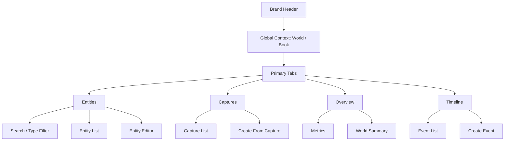
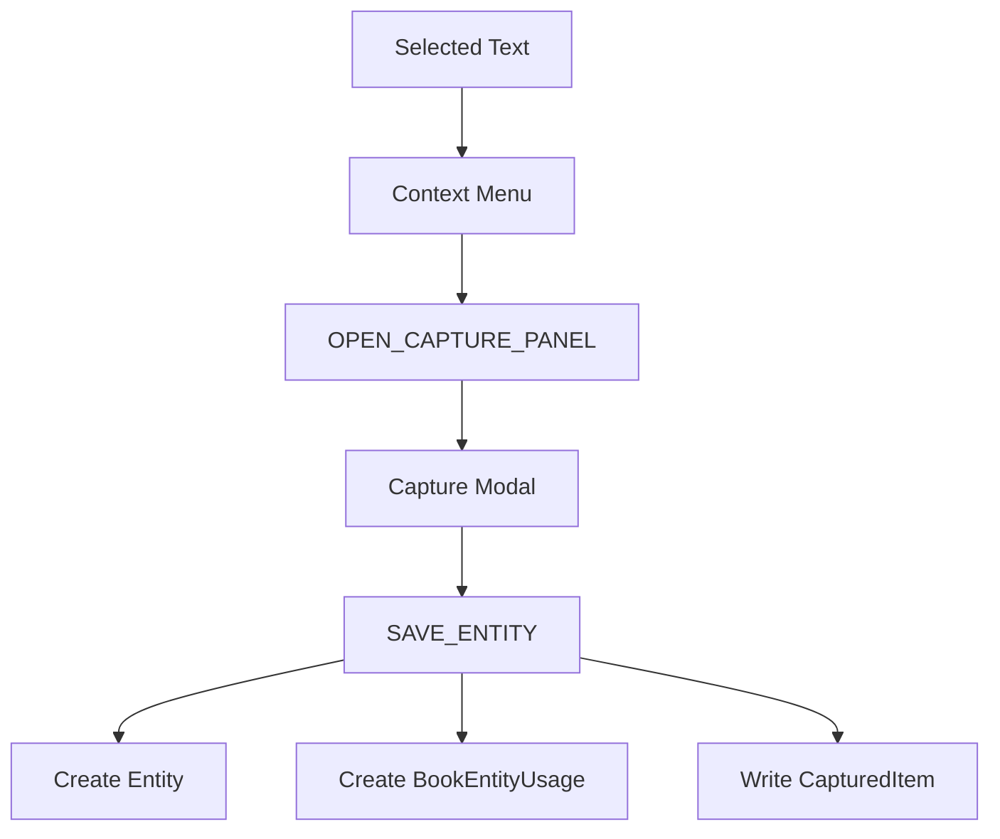

# World-Link Alpha PRD

- Owner: 产品 / 前端 / 后端联合维护
- Last Updated: 2026-04-21
- Status: active
- Scope: 定义当前产品定位、能力边界、迭代路线与评分基线

## 1. Executive Summary

### Problem Statement

虚构世界观创作者在浏览网页、写书和整理设定时，长期面临三个连续问题：

- 灵感来源分散，看到“矿石 / 势力 / 地名 / 历史事件”时很难即时结构化收集；
- 世界观会跨多本书复用，但传统笔记工具无法表达“世界级资产”与“书级使用视图”；
- 当实体数量增长后，纯文本整理很快失去检索效率和复用效率。

### Proposed Solution

World-Link Alpha 是一个 **Chrome Sidepanel + 网页采集弹窗** 的双入口工具：

- 在网页中，用户可以右键把选中文本直接转成结构化实体；
- 在 Sidepanel 中，用户持续管理 `世界 / 书项目 / 实体 / 捕获记录`；
- 通过 `BookEntityUsage` 把“世界资产”映射到“某本书实际用到的资产集合”。

### Success Criteria

当前阶段先以 MVP 的可用性和结构稳定性为目标，建议使用以下指标：

1. 用户能在 **30 秒内** 完成一次网页划词到实体创建；
2. 用户能在 **3 步内** 找到当前世界下的目标实体；
3. 在选定书项目后，实体列表能稳定切换到“仅本书使用”视图；
4. Sidepanel 在 `320px–520px` 宽度内不出现横向滚动；
5. 文档与当前代码实现口径一致，不再出现已删除交互的描述。

### Metric Contract（指标口径与归属）

| 指标名 | 计算口径 | 数据来源 | 负责人角色 | 复核频率 |
| --- | --- | --- | --- | --- |
| 网页采集成实体时长 P90 | 从触发右键菜单到实体保存成功的耗时分布，取 P90 | 插件端埋点 + `background.js` 处理日志 | 前端负责人 | 每周 |
| 实体检索效率 | 在有世界上下文前提下，完成“搜索并打开目标实体”步骤数 ≤ 3 的比例 | 可用性走查记录 + 用户行为埋点 | 产品经理 | 双周 |
| 新手激活完成率 | 登录后会话中完成“世界→作品→设定→灵感→绑定”五步闭环的比例 | 激活事件埋点（`activation_*`） | 产品经理 | 每周 |
| 书项目过滤准确率 | 选定书项目后，实体列表与 `bookEntityUsages` 关系一致的请求比例 | `CloudRepository` 查询日志 + 本地回归脚本 | 前端负责人 | 每周 |
| Sidepanel 布局稳定率 | `320px–520px` 下无横向滚动、关键区域无溢出的检查通过率 | 手工回归清单 + UI 视觉验收记录 | UI 设计师 | 每周 |
| 文档一致性通过率 | 文档检查脚本在主分支 CI 与本地提交前均通过的比例 | `scripts/check-docs-consistency.mjs` 执行记录 | 项目维护者 | 每次提交 |

---

## 2. 产品定义

### 产品名称
- World-Link Alpha

### 产品形态
- Chrome Extension
- 由三部分组成：
  - `content.js`：网页内结构化采集弹窗
  - `background.js`：右键入口与采集路径存储协调
  - `sidepanel`：世界观资产的持续管理界面

### 一句话定位
- 面向虚构世界观创作者的 **设定采集与结构化管理工具**

### 术语策略（对外文案 v1）

> 从本版本开始，界面与运营文案统一使用“用户可直接理解”的术语；技术模型仍保留 `Entity` 等命名，不影响代码层与消息协议。

| 技术词（内部） | 对外显示词（用户） | 说明 |
| --- | --- | --- |
| `World` | 世界观库 | 一个可复用的设定资产库 |
| `Book` / `Book Project` | 当前作品 | 用户正在创作的具体书/项目 |
| `Entity` | 设定（设定卡） | 人物/地点/势力/物品等结构化条目 |
| `CapturedItem` | 灵感记录 | 从网页划词采集的原始素材 |
| `BookEntityUsage` | 作品已使用设定 | 某条设定是否被当前作品使用 |

术语落地原则：
1. 任何面向用户的入口文案，优先用“设定 / 作品 / 灵感”；
2. 技术术语仅在文档或开发者上下文中出现，避免 UI 暴露；
3. 若必须出现双语，统一格式：`设定（Entity）`。

### 当前版本判断
- 当前项目已经不是“只有划词捕获的 demo”
- 它已经具备一套真实的产品骨架：
  - 有稳定的数据模型
  - 有网页采集入口
  - 有 Sidepanel 管理入口
  - 有世界 / 书 / 实体 / 捕获的基础对象
  - 有面向图谱、导出、书稿解析、AI 能力的扩展空间

### 形态演进策略（新增）
- 插件到 Web/后台管理的落地策略，采用“**非微前端 + 多应用**”路径。
- 演进触发节点与阶段目标详见：`docs/prd/web-admin-evolution-roadmap.md`。

---

## 3. 用户与场景

### 核心用户
- 长篇网文作者
- 剧本杀作者 / 主笔
- 设定量较大的独立游戏叙事设计者

### 次级用户
- TRPG 主持人
- 世界观设定爱好者 / OC 玩家

### 高频场景
1. 在网页看到一个可用设定，立刻收进自己的世界
2. 在某个世界下维护多本书项目
3. 在写某本书时，只看“本书实际使用”的实体
4. 从历史捕获记录中二次整理成实体

---

## 4. Goals / Non-Goals

## 4.1 Goals

### G1. 建立稳定的资产模型
- 统一 `World / Book / Entity / CapturedItem / BookEntityUsage`

### G2. 降低采集成本
- 把“看到好设定 → 收进工具”的路径缩短到右键 + 一个结构化表单

### G3. 支撑多书复用
- 让“世界级资产”和“书级使用视图”可以共存

### G4. 让 Sidepanel 成为高频工作台
- 不做展示型页面，而是让搜索、过滤、编辑能稳定承载高频使用

## 4.2 Non-Goals

当前版本明确不做以下内容：

1. **不做“整本书全自动世界观还原”**
   - 当前仅支持片段级解析与关系推断，仍保留人工确认环节

2. **不做复杂逻辑审计引擎**
   - 当前以冲突提醒和关系编辑为主，不做全链路自动裁决

3. **不做全自动关系批处理落库**
   - 关系推断结果先回填编辑器，由用户确认后写入，避免误写入污染

4. **当前版本不做正式协同编辑**
   - 维持单用户优先工作流，团队权限与评论流放在后续阶段评估

---

## 5. 当前产品范围

> 本节严格按当前代码已实现能力定义，而不是按早期设想定义。

## 5.1 已实现能力

### A. 网页结构化采集
- 用户在网页中选中文本
- 右键点击 `存入 World-Link`
- `content.js` 打开采集弹窗
- 用户可填写：
  - 世界
  - 类型
  - 名称
  - 描述
  - 标签
  - 关联书项目
- 保存后：
  - 创建实体
  - 写入 `BookEntityUsage`
  - 写入 `capturedList`
  - Toast 成功反馈

### B. Sidepanel 全局上下文
- 选择当前世界
- 选择当前书项目
- 世界 / 书项目的选择影响后续实体视图范围
- 未登录时首屏不再把鉴权缺失映射为“加载失败”，而是进入登录引导态
- 已登录但未完成关键动作时，展示“新手激活任务流”卡片（五步闭环）
- 支持分步 Tour 引导（高亮目标区域 + 指示箭头 + 自动滚动 + 上一步/下一步 + 即时动作）
- 支持引导蒙层目标穿透点击（仅高亮目标可直接操作）
- Tour 支持按步骤完成状态自动推进，并从首个未完成步骤启动
- 已接入激活埋点与引导行为埋点（事件字典见 `docs/prd/activation-event-dictionary.md`）
- 账号弹窗提供开发调试入口（仅开发构建可见）：可查看激活埋点快照、刷新/清空事件，并导出 JSON

### C. Sidepanel 一级任务架构
- `实体`
- `捕获`
- `时间轴`
- `概览`

### D. 实体管理
- 新建实体
- 编辑实体
- 按当前世界过滤
- 按当前书项目过滤
- 按名称 / 描述搜索
- 按类型过滤
- 按标签过滤（预置标签 + 自定义标签）
- 标签编辑 v2（chip 删除、快捷添加、建议补全）
- 导出当前筛选实体（JSON / Markdown，v2 结构增强）
  - Markdown：结构概览 + 关系分布 + 当前作品写作模板
  - JSON：`version` + `stats` + `relations` + `entities`
- 在当前书项目下绑定或解绑实体
- 在实体编辑器中维护实体关系（所属 / 敌对 / 亲属 / 使用 / 起源于 / 关联）
- 在实体编辑器中使用 AI 总结 / 扩写（Pro 门禁）
- 在实体编辑器中使用 AI 查重 / 冲突提醒（Pro 门禁）
- 在实体编辑器中使用 AI 生成配图（时间轴持久化 + 历史资产 + 重试生成）
- 在编辑器中展示 AI 执行来源（云端模型 / 本地兜底）与最近处理时间
- 在实体页使用书稿自动解析（候选设定提取 + 关系推断 + 一键回填）
- 空状态引导（无世界 / 无结果 / 本书无绑定）与下一步 CTA

### E. 捕获记录管理
- 展示捕获列表
- 展示时间、来源、热度
- 状态管理（未整理 / 已整理 / 已转实体）
- 按状态 / 来源 / 时间过滤
- 从捕获记录快速回填到实体编辑
- 空状态引导（无捕获 / 筛选无结果）与下一步 CTA

### F. 概览页
- 展示世界 / 书 / 实体 / 捕获 / 关系统计
- 展示跨世界快览 v1（世界列表 + 作品/设定/关系计数 + 搜索/排序/活跃分组 + 一键切换）
- 展示类型分布、最近更新实体、最近捕获记录
- 展示关系图谱预览（可缩放 / 可拖拽 / 节点高亮）
- 支持「世界图谱 / 本书图谱」切换
- 本书图谱支持独立目标书切换（不改全局上下文）
- 展示关系类型分布、最近关系边与焦点节点关系明细
- 展示最近动态摘要，并支持跳转到时间轴 Tab 查看完整事件流

### G. 时间轴管理（v1）
- 时间轴作为独立一级 Tab 入口（`timeline`）
- 支持世界 / 设定级事件的创建 / 查询 / 删除
- 支持“时间轴事件 -> 关系草稿 / 关系落库”联动
- 支持按时间倒序浏览关键事件流

### H. 账号、云端与套餐门禁
- 支持本地登录会话（`SET_AUTH_SESSION`）与云端登录（`SIGN_IN_WITH_PASSWORD`）
- 账号与同步入口采用 Header 右上角触发弹窗，避免首屏挤占核心工作区
- 用户侧采用“登录即同步”模型，不暴露 `local/cloud` 模式切换与 Cloud API 技术配置
- 未登录首屏改为 `开始使用` 引导卡，明确当前版本需登录后才能创建世界观库、当前作品和设定
- 运行配置在消息层统一归一化（`repositoryMode`、`cloudApiBaseUrl`、`cloudTimeoutMs`）
- 支持本机数据一键迁移到云端（`MIGRATE_LOCAL_TO_CLOUD`）
- 支持云端 401 自动刷新 refresh token
- 支持 Entitlements 同步与展示（Free / Pro）
- 支持导出授权门禁与日计量（Markdown/JSON）
- 支持云端请求 traceId 与错误分层反馈（便于联调与排障）
- 关键消息已接入前置参数校验，非法 payload 统一返回 `errorType: 'validation'`

## 5.2 已知差距

### 产品差距
- 世界级图谱力导向布局已落地，当前仍缺大规模关系性能优化
- 世界级图谱 v4 已落地（布局缓存 / 拖拽节流 / 渲染模式 / 分批加载 / 焦点下钻）
- 跨世界快览 v1 已落地，当前仍缺按标签/领域分组的深度浏览能力
- AI 总结 / 扩写已切到后端 API 主链路（Sidepanel 不再走 runtime mock），仍需服务端质量联调
- AI 查重 / 冲突提醒已切到后端 API 主链路，仍需语义阈值和解释策略标定
- AI 兜底已补齐结构化原因字段（`fallbackType/status/retriable/traceId`）与统一文案映射（超时/网络/鉴权/限流/服务异常）
- 冲突检测结果已补齐 `reasonCode` 与风险分级（高/中/低），便于前端一致化解释与排序
- AI 文案已支持策略参数（风格/长度）并在云端与本地兜底保持一致输出口径
- 冲突检测结果已支持按风险等级快速筛选，提升大批量设定校对效率
- 冲突结果已补充按 `reasonCode` 的处理建议模板，降低“发现冲突但不知道怎么改”的阻力
- 冲突检查已支持风险分布摘要与策略版本回传（`strategyVersion`），便于联调阈值口径
- 冲突检查已支持阈值快照回传（`calibration`），可在编辑器中直接对照“名称/描述/风险阈值”
- AI 总结 / 扩写已支持质量元信息回传（`qualityScore/qualityTier/qualityLabel`）与策略版本展示
- AI 联调反馈回路已接入（结果有帮助/需优化、检测准确/需校准），用于服务端质量与阈值迭代
- 书稿自动解析 v1 已切到 `POST /api/ai/parse-manuscript`，支持候选设定 + 关系推断回填
- 关系编辑器已支持“名称展示 + ID 持久化”的可用交互（目标设定下拉选择、关系类型、备注）
- 时间轴视图已到 v1（独立 Tab + 状态演化 + 关系联动），后续仍缺高级筛选、批量编辑与事件模板
- 逻辑审计还未落地
- 云端服务端接口仍需联调与稳定性验证（插件侧已接入 CloudRepository + Entitlements）

### 视觉差距
- Sidepanel 与网页采集弹窗已统一为白底卡片体系
- 风格基线已确定并落地（`docs/design/style-decision-v1.md` + `stylekit-theme-v1.css`）
- 关系图谱区已新增状态提示条（渲染模式/采样说明/分批加载提示）与“清除焦点”操作
- 需要继续做细节打磨（图标体系、层级一致性、过渡动画）

## 5.3 功能覆盖矩阵（2026-04-19 对齐）

| 能力域 | 当前状态 | 当前口径（以代码与 TODO 为准） | 下一里程碑 |
| --- | --- | --- | --- |
| 网页采集（划词 -> 设定） | done | 已形成稳定主链路（创建实体 + 写入捕获 + 作品绑定） | 提升字段建议与容错体验 |
| 设定管理（CRUD/过滤/关系/导出） | done | 支持搜索、类型/标签过滤、关系维护、JSON/Markdown 导出；已补来源追溯与被使用次数展示（v0） | 增强批量操作与性能、补历史追溯深度 |
| 灵感收件箱 | done | 状态管理与回填设定流程可用 | 增加优先级/批处理整理 |
| 概览与关系图谱 | done | 世界/本书图谱切换、跨世界快览、关系分布可用 | 深化大规模关系性能与分组浏览 |
| 时间轴（独立 Tab） | done | v1 已落地（事件 API + 状态演化 + 关系联动） | 增加高级筛选与模板化录入 |
| AI 总结/扩写 + 冲突检查 | done | 云端主链路 + 兜底机制 + 风险解释已接入 | 持续做质量与阈值标定 |
| 书稿解析（候选 + 关系推断） | done | 已支持候选设定与关系回填 | 补自动批处理与质量评估 |
| 生图能力 | done | 已完成时间轴持久化（`image_generated`）、历史资产列表、重试生成与“设为当前” | 增加批量生成与图片质量评价体系 |
| 协作与权限 | todo | 当前维持单用户优先 | 评估团队权限与评论流 |
| 模板/设定市场 | todo | 未进入主线开发 | 在主链路稳定后推进 |
| Web/Admin 演进 | in_progress | 已有 Gate 机制与迁移路径 | 按 Gate 节奏推进 Beta/Alpha |

---

## 6. 核心对象模型

### World
- 世界级容器
- 承载该世界下的书项目和实体

### Book
- 某个世界下的具体作品视图
- 目标是表达“某本书实际使用了哪些世界实体”

### Entity
- 最小结构化资产单元
- 当前支持的类型包括：
  - 人物
  - 地点
  - 势力 / 组织
  - 物品 / 武器
  - 矿石 / 资源
  - 生物 / 怪物
  - 事件
  - 规则 / 法则
  - 其他

### CapturedItem
- 原始采集记录
- 当前主要作用：
  - 留存原始来源
  - 用于二次整理
  - 作为未来“采集收件箱”的数据基础

### BookEntityUsage
- 书项目与实体之间的关系
- 用于：
  - “仅看本书使用实体”过滤
  - 后续书级图谱
  - 后续书级逻辑审计

### EntityRelation
- 实体与实体之间的关系边
- 当前字段：
  - `worldId`
  - `fromEntityId`
  - `toEntityId`
  - `type`
  - `note`
- 当前作用：
  - 支撑后续世界级 / 书级图谱渲染
  - 作为未来逻辑冲突检测的结构化输入

---

## 7. 信息架构与页面结构

## 7.1 信息架构原则

1. `世界 / 书项目` 是全局上下文，不属于任何单个 Tab
2. Tab 是任务切换，不是视觉装饰
3. `实体` 是默认首页，因为它承接最高频任务
4. `捕获` 是素材收件箱
5. `时间轴` 是独立事件工作台，不放在概览中承载完整编辑流
6. `概览` 是低频总览，不应承担重编辑

## 7.2 Sidepanel IA

## 7.3 网页采集路径

---

## 8. 用户故事与验收标准

## 8.1 User Stories

### S1. 即时采集
- 作为创作者，我希望在网页上看到一个设定时能立刻把它收入世界，以免灵感丢失

### S2. 世界级复用
- 作为创作者，我希望一个实体先属于世界，再决定是否用于某本书，这样设定可以跨作品复用

### S3. 本书视图
- 作为正在写某本书的用户，我希望只看本书真正使用到的实体，减少干扰

### S4. 二次整理
- 作为用户，我希望历史捕获记录能快速回填成实体，减少重复录入

### S5. 时间轴维护
- 作为创作者，我希望在独立时间轴中维护事件流，并将关键事件联动到关系编辑

## 8.2 Acceptance Criteria

### AC-1 网页采集
- 用户选中文字后可通过右键菜单打开采集弹窗
- 采集弹窗至少包含世界、类型、名称、描述、标签、书项目
- 未选择世界或未填写名称时不得保存

### AC-2 实体创建
- 保存后必须创建实体
- 若勾选书项目，必须写入 `BookEntityUsage`
- 原始文本必须写入 `capturedList`

### AC-3 Sidepanel 过滤
- 未选世界时，不展示误导性实体空列表
- 选定书项目后，实体列表仅展示该书已使用实体
- 实体搜索必须对名称和描述同时生效

### AC-4 捕获 → 实体
- 用户在捕获页点击“从此创建实体”后，系统切换到实体页
- 表单需预填名称、摘要、来源信息

### AC-5 时间轴 Tab
- 时间轴作为一级 Tab 可独立访问，不依赖总览页展开
- 用户可创建、浏览、删除世界/设定级事件
- 事件可联动为关系草稿或直接写入关系

---

## 9. 技术结构与代码映射

## 9.1 当前代码映射

- `background.js`
  - 右键菜单
  - 采集路径写入
  - 消息分发

- `content.js`
  - 采集弹窗
  - 页面级 Toast
  - 采集表单校验与提交

- `sidepanel/src/App.jsx`
  - 全局状态
  - 世界 / 书 / 实体 / 捕获 / 时间轴 / 概览的组合壳层

- `sidepanel/src/components/WorldBookSection.jsx`
  - 全局上下文

- `sidepanel/src/components/PrimaryTabBar.jsx`
  - 一级任务切换

- `sidepanel/src/components/EntitySection/index.jsx`
  - 实体搜索、类型过滤、列表、编辑

- `sidepanel/src/components/CaptureSection.jsx`
  - 捕获记录与回填入口

- `sidepanel/src/components/TimelineSection.jsx`
  - 时间轴事件管理与关系联动入口

- `sidepanel/src/components/WorldSummaryCard.jsx`
  - 概览内容

- `sidepanel/src/index.css`
  - 当前主要 token 与布局规范

## 9.2 当前技术判断

- 当前结构适合 MVP 快速迭代
- 当前写入路径已统一收敛到 `background.js`（单写入通道）
- `DataRepository` 已支持 `LocalRepository / CloudRepository` 双实现与运行时切换
- 账号体系已接入：本地会话 + 云端密码登录 + token 刷新
- Freemium 门禁已接入：世界/书/实体/捕获额度 + 导出权限控制
- 下一阶段重点转向服务端联调、订阅回写与默认云端切换

---

## 10. 风险与路线图

## 10.1 风险

### R1. 文档与实现漂移
- 项目历史上已经出现过“旧交互已删，但文档仍保留”的问题

### R2. 数据模型扩展风险
- 关系图谱、书稿解析、逻辑审计上线后，字段与索引复杂度会快速上升

### R3. Sidepanel 信息拥挤
- 如果不继续做任务分层和组件拆分，后续图谱 / 导出 / AI 能力会迅速压垮单页体验

## 10.2 Roadmap

### MVP+（短期）
1. 标签过滤 UI
2. 导出能力（JSON / Markdown）
3. 概览页升级
4. UI 视觉统一（网页采集弹窗 ↔ Sidepanel）

### v1（中期）
1. 跨世界快览 v1（分组/排序/筛选）+ 世界图谱性能优化
2. 采集收件箱状态管理（未整理 / 已整理）
3. 云端账号与订阅分层（Free / Pro）

### v2（中远期）
1. 书稿自动解析
2. 逻辑审计
3. AI 总结 / 扩写 / 冲突提醒

## 10.3 版本冻结规则（90 分冲刺期）

为避免“并行战线过多”继续拉低路线聚焦度，从 2026-04-19 起启用以下冻结规则：

1. `SCORE-01`（新手激活闭环）与 `SCORE-02`（来源追溯）未完成前，不新开平台化新模块。
2. AI 方向只允许做“带引用的资产问答 + 语义检索增强”，不新增泛聊天页。
3. Web/Admin 只按 Gate 推进，不允许跳 Gate 进入微前端或复杂协作能力。
4. 每周例会必须先复盘“激活 / 复用 / 留存”三组指标，再讨论新增功能。

---

## 11. 产品判断

当前 World-Link Alpha 最重要的不是继续加“炫功能”，而是把下面三件事做扎实：

1. **模型稳定**
   - 先让世界 / 书 / 实体 / 使用关系稳定

2. **工作流顺**
   - 让网页采集与 Sidepanel 管理形成闭环

3. **界面可信**
   - 让 Sidepanel 成为一个可高频打开、不会越用越乱的工具界面

---

## 12. 产品评估评分卡（2026-04-19）

### 12.1 基线评分（首次评估）

| 维度 | 权重 | 基线得分（10 分制） | 基线加权分 |
| --- | --- | --- | --- |
| 问题-方案匹配度 | 20% | 9.0 | 18.0 |
| 核心工作流闭环 | 20% | 8.5 | 17.0 |
| 可用性与信息架构 | 15% | 8.0 | 12.0 |
| 差异化与定位清晰度 | 15% | 8.0 | 12.0 |
| 商业化可执行性 | 10% | 7.5 | 7.5 |
| 文档治理与一致性 | 10% | 6.5 | 6.5 |
| 路线聚焦度（克制度） | 10% | 6.0 | 6.0 |

**基线综合评分：79.0 / 100（B+）**

### 12.2 90 分冲刺补强（本轮已纳入文档）

1. 补齐缺失专题文档链路：Web/Admin Gate、测试策略、E2E 清单、测试资产台账。
2. 统一口径治理：`PRD/README` 改为 Active/Deprecated 双区，旧订阅文档降级为历史留档。
3. 增加评分驱动优先级（SCORE-01~04）并写入 `TODO`。
4. 增加“版本冻结规则”，明确冲刺期不再横向扩散功能面。

### 12.3 复评结果（文档与规划成熟度）

| 维度 | 权重 | 复评得分（10 分制） | 复评加权分 | 提升原因 |
| --- | --- | --- | --- | --- |
| 问题-方案匹配度 | 20% | 9.0 | 18.0 | 主链路与用户价值保持稳定 |
| 核心工作流闭环 | 20% | 8.8 | 17.6 | 闭环指标和 DoD 约束更完整 |
| 可用性与信息架构 | 15% | 8.5 | 12.8 | 任务分层与验收清单联动加强 |
| 差异化与定位清晰度 | 15% | 8.8 | 13.2 | 明确“资产问答”而非泛聊天 |
| 商业化可执行性 | 10% | 8.5 | 8.5 | Entitlements + 测试门禁 +放行模板成体系 |
| 文档治理与一致性 | 10% | 9.2 | 9.2 | 索引、状态、缺失文档、校验脚本全部闭环 |
| 路线聚焦度（克制度） | 10% | 8.7 | 8.7 | 新增冻结规则，限制并行扩散 |

**复评综合评分：90.0 / 100（A-）**

### 12.4 评分解释（避免“只改分数”）

1. `90.0/100` 代表“文档与规划成熟度”已达 90 分。
2. 产品运行实绩仍需通过线上指标持续验证，不能用文档评分替代业务结果。
3. 若 2026-05-20 前未达成激活与留存门槛，评分将回退到 85 分以下并重新评审。

### 12.5 90 分实绩门槛（2026-05-20 前）

| 指标 | 口径 | 目标 |
| --- | --- | --- |
| D1 激活完成率 | 新用户在 24 小时内完成“采集→设定→绑定作品” | >= 45% |
| D7 留存率 | D0 激活用户在 D7 至少一次编辑行为 | >= 18% |
| 复用率 | 活跃用户中，至少 1 条设定被 2 本以上作品使用 | >= 20% |
| Free→Pro 转化率 | 触发门禁后 14 天内升级比例 | >= 3% |
| 发布可用性 | RC 阶段 P0 必过项通过率 | 100% |

执行排期与证据模板见：`docs/prd/score-90-execution-plan.md`。
