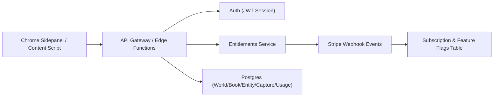

# PRD：云端存储与免费/收费分层（Freemium + Cloud）

## 1. Executive Summary

### Problem Statement

当前数据仅存储在插件本地（`chrome.storage.local`），会导致跨设备不可用、卸载即丢失、以及难以实现可控的付费分层与服务端风控。

### Proposed Solution

将 World-Link Alpha 升级为 **云端主存储 + 账号体系 + 订阅授权（Entitlements）** 的架构。  
免费用户使用基础采集与管理能力；收费用户解锁更高配额与高级能力（AI、图谱、协作等）。

### Success Criteria

1. 90% 以上活跃用户在登录后 5 秒内完成首屏数据加载；  
2. 多设备同步成功率 ≥ 99.5%；  
3. 免费转付费月转化率达到 3%+（初始目标）；  
4. 数据丢失工单数下降 80% 以上；  
5. 付费能力误判率（该开通未开通 / 该限制未限制）低于 0.3%。

---

## 2. 为什么“不只存本机”是对的

从技术与产品一致性看，纯本地存储有 4 个硬伤：

1. **可持续性差**：浏览器重装/清理缓存/换设备都会中断资产沉淀；
2. **商业化难**：付费能力很难只靠前端做可靠鉴权，易被绕过；
3. **风控能力弱**：无法做服务端限流、行为审计、异常账号封控；
4. **生态扩展受限**：后续协作、云备份、团队版几乎都要求云端主数据。

> 结论：你的判断是对的，长期必须从“本地主存储”切到“云端主存储”。

---

## 3. 可行技术方案评估（替代本机存储）

## 3.1 方案 A：Supabase（Auth + Postgres + RLS）+ Stripe

**优点**
- 上手快，适合小团队快速迭代；
- Postgres + RLS 非常适合多租户（按用户隔离）；
- SQL 能力强，后续做图谱、统计、检索扩展空间大。

**缺点**
- 高并发下需关注连接池、索引和查询成本；
- 复杂实时场景需要额外设计（订阅、缓存、队列）。

**适配判断**
- 对当前 World-Link Alpha 最均衡，推荐优先。

## 3.2 方案 B：Firebase（Auth + Firestore）+ Stripe

**优点**
- 客户端 SDK 成熟，实时同步体验好；
- 无服务器运维负担低。

**缺点**
- 文档型查询在复杂筛选/聚合上不如 SQL 直观；
- 成本预测在数据量增长后需要精细化治理。

**适配判断**
- 可行，但对“复杂查询 + 后续关系图谱”可维护性略逊。

## 3.3 方案 C：Cloudflare（Workers + D1/KV）+ 第三方 Auth + Stripe

**优点**
- 全球边缘访问快；
- Workers 成本友好，部署效率高。

**缺点**
- 初期组合件较多（Auth/支付/数据）；
- 团队需要更强的后端工程治理能力。

**适配判断**
- 更偏工程导向，适合中后期成本优化或全球化扩展。

---

## 4. 推荐落地架构（建议）

**推荐：A 方案（Supabase + Stripe）**

### 4.1 核心原则

1. **云端主存储**：业务真相只在云端；
2. **客户端无长期主数据**：默认不写本地持久库；
3. **能力由服务端裁决**：是否可用 AI/图谱/导出等，统一走 Entitlements；
4. **前端只做体验，不做付费安全边界**。

### 4.2 “不落本机”的实现方式

- 默认策略：**纯云端读写 + 内存态缓存（会话级）**；  
- 关闭 `chrome.storage.local` 的业务主数据写入；  
- 如果未来要离线模式，作为付费增值能力单独设计（可选加密缓存）。

---

## 5. 免费/收费能力差异（首版建议）

## 5.1 功能矩阵

| 模块 | 免费用户（Free） | 收费用户（Pro） |
| --- | --- | --- |
| 世界与书项目 | 最多 1 个世界 / 3 本书 | 不限 |
| 实体数量 | 最多 500 个实体 | 不限（或高上限） |
| 捕获量 | 每日 200 条 | 高配额 / 不限 |
| 基础能力 | 划词采集、标签、搜索、基础过滤 | 全量基础能力 |
| 导出 | 仅 Markdown（限次） | Markdown + JSON（不限） |
| 图谱 | 只读预览（后续） | 可编辑全功能（后续） |
| AI 摘要/冲突提醒 | 不可用 | 可用（按额度计费或月配额） |
| 同步与备份 | 基础云同步 | 优先队列 + 历史版本恢复 |
| 支持与服务 | 社区支持 | 优先支持 |

> 注：阈值是首版运营参数，后续可通过服务端配置热更新，无需发版插件。

## 5.2 计费与鉴权策略

- 支付：Stripe Subscription；
- 订阅事件：Webhook 写入 `subscription_status`；
- 授权判定：服务端下发 `entitlements`（功能旗标 + 配额）；
- 客户端每次关键操作（导出/AI/图谱写入）均做服务端校验。

---

## 6. 技术规格（与当前项目衔接）

## 6.1 数据层改造

新增 `DataRepository` 抽象：

- `LocalRepository`（仅迁移期保留）  
- `CloudRepository`（目标实现）

当前 `background.js` 中的读写逻辑收敛到 `repository.*` 接口，便于切换。

## 6.2 新增服务端模型（建议）

- `users`
- `subscriptions`
- `entitlements`
- `worlds`
- `books`
- `entities`
- `book_entity_usages`
- `captures`
- `usage_logs`（计量）

## 6.3 安全与隐私

- 所有业务表按 `user_id` 做隔离（RLS/ACL）；
- Webhook 验签 + 幂等处理；
- 最小权限访问令牌；
- 采集来源 URL 作为用户私有数据，默认不公开。

---

## 7. 分阶段实施路线

### 当前实现快照（2026-04-15）

- 插件侧已完成：
  - `CloudRepository` 接口实现（`/v1/store` 读写）
  - 内部运行模式（`local/cloud`）与 Cloud API 配置（用户侧已计划收敛隐藏）
  - 云端密码登录（`/v1/auth/login`）与 refresh token 自动续期（`/v1/auth/refresh`）
  - Free/Pro 客户端门禁（世界/书/实体/捕获额度 + 导出权限 + 日计量）
- 待完成：
  - 服务端接口联调与异常兜底策略
  - 订阅状态与 entitlements 服务端强校验
  - 默认切换为云端主存储

### Phase 0（1 周）：架构抽象准备

1. 引入 `DataRepository` 与 `EntitlementGuard`；
2. 所有写入统一走 repository；
3. 保持现网可运行（本地兼容仅作为内部兜底）。

### Phase 1（2 周）：云端主存储上线

1. 接入账号登录；
2. 上线云端 CRUD；
3. 默认切换云端读写；
4. 本地仅留会话态缓存，不落持久主数据。

### Phase 2（1~2 周）：付费分层上线

1. 接 Stripe；
2. 上线 entitlements 服务；
3. 按功能矩阵做能力开关与配额限制；
4. 上线免费触顶引导（升级 CTA）。

### Phase 3（持续）：高级能力与运营优化

1. AI、图谱、版本恢复；
2. 分层运营实验（价格、配额、触发点）；
3. 成本与毛利持续优化。

---

## 8. 风险与应对

1. **登录门槛导致流失**  
   - 应对：提供“游客浏览 + 登录后保存”的轻引导。

2. **迁移期数据丢失风险**  
   - 应对：提供一次性“本地导入云端”迁移向导与校验。

3. **配额策略过严影响口碑**  
   - 应对：先宽后紧，先观察转化漏斗再动态调整。

4. **支付/授权一致性问题**  
   - 应对：Webhook 幂等 + 定时对账 + 客户端兜底刷新令牌。

---

## 9. Open Questions（待确认）

1. 免费版是否允许团队协作邀请（建议：不允许）；  
2. 是否提供“本地离线模式”作为 Pro 增值能力；  
3. AI 能力走“月度额度”还是“按量付费”；  
4. 是否在中国区增加本地化支付方案（后续可选）。

---

## 10. 决策闭环表（新增）

| Question | Owner | Due | Decision | UpdatedAt |
| --- | --- | --- | --- | --- |
| 免费版是否允许团队协作邀请？ | 产品经理 | 2026-04-22 | 待决策 | 2026-04-15 |
| 是否提供本地离线模式作为 Pro 增值能力？ | 产品经理 | 2026-04-25 | 待决策 | 2026-04-15 |
| AI 能力采用“月度额度”还是“按量付费”？ | 产品经理 + 商业化负责人 | 2026-04-28 | 待决策 | 2026-04-15 |
| 中国区是否增加本地化支付方案？ | 商业化负责人 | 2026-05-08 | 待决策 | 2026-04-15 |

> 维护约定：Open Questions 保留问题池表达；一旦进入评审排期，必须同步写入本表并持续更新 Decision / UpdatedAt。

---

## 10. 参考资料（官方）

- Chrome Extension Storage API: https://developer.chrome.com/docs/extensions/reference/api/storage  
- Supabase Auth with RLS: https://supabase.com/docs/guides/database/postgres/row-level-security  
- Supabase Pricing: https://supabase.com/pricing  
- Firebase Firestore Pricing: https://firebase.google.com/docs/firestore/pricing  
- Stripe Entitlements: https://docs.stripe.com/billing/entitlements  
- Stripe Subscriptions Overview: https://docs.stripe.com/billing/subscriptions/overview  
- Cloudflare Workers Pricing: https://developers.cloudflare.com/workers/platform/pricing/
