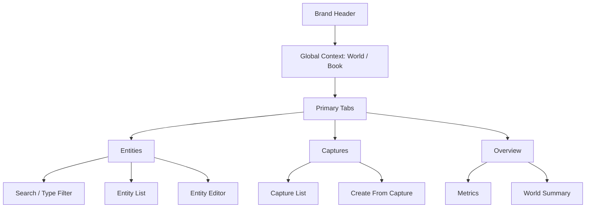
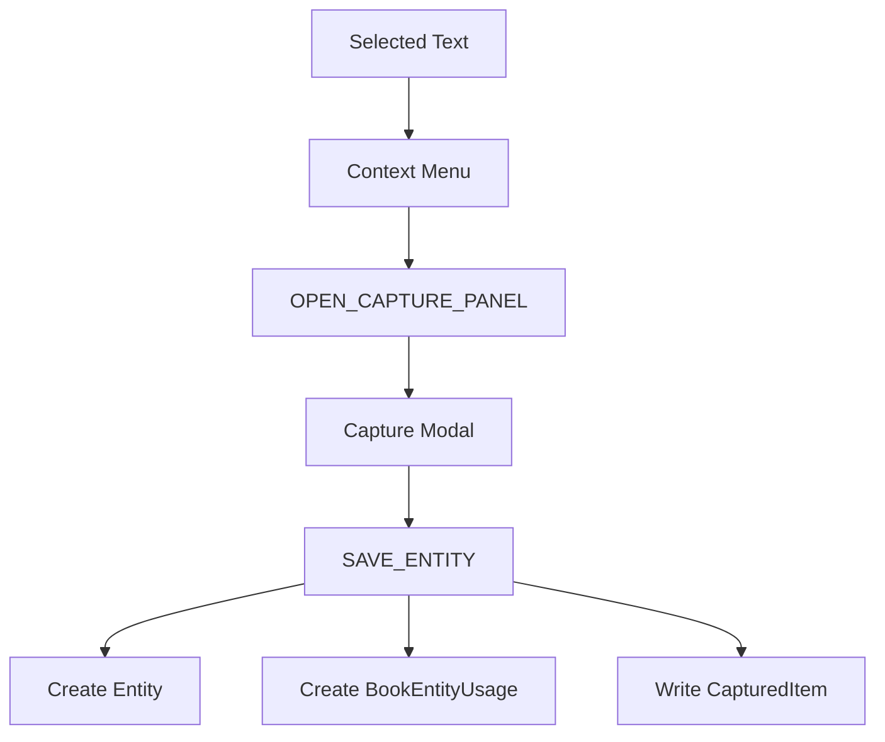

# World-Link Alpha PRD

## 1. Executive Summary

### Problem Statement

虚构世界观创作者在浏览网页、写书和整理设定时，长期面临三个连续问题：

- 灵感来源分散，看到“矿石 / 势力 / 地名 / 历史事件”时很难即时结构化收集；
- 世界观会跨多本书复用，但传统笔记工具无法表达“世界级资产”与“书级使用视图”；
- 当实体数量增长后，纯文本整理很快失去检索效率和复用效率。

### Proposed Solution

World-Link Alpha 是一个 **Chrome Sidepanel + 网页采集弹窗** 的双入口工具：

- 在网页中，用户可以右键把选中文本直接转成结构化实体；
- 在 Sidepanel 中，用户持续管理 `世界 / 书项目 / 实体 / 捕获记录`；
- 通过 `BookEntityUsage` 把“世界资产”映射到“某本书实际用到的资产集合”。

### Success Criteria

当前阶段先以 MVP 的可用性和结构稳定性为目标，建议使用以下指标：

1. 用户能在 **30 秒内** 完成一次网页划词到实体创建；
2. 用户能在 **3 步内** 找到当前世界下的目标实体；
3. 在选定书项目后，实体列表能稳定切换到“仅本书使用”视图；
4. Sidepanel 在 `320px–520px` 宽度内不出现横向滚动；
5. 文档与当前代码实现口径一致，不再出现已删除交互的描述。

### Metric Contract（指标口径与归属）

| 指标名 | 计算口径 | 数据来源 | 负责人角色 | 复核频率 |
| --- | --- | --- | --- | --- |
| 网页采集成实体时长 P90 | 从触发右键菜单到实体保存成功的耗时分布，取 P90 | 插件端埋点 + `background.js` 处理日志 | 前端负责人 | 每周 |
| 实体检索效率 | 在有世界上下文前提下，完成“搜索并打开目标实体”步骤数 ≤ 3 的比例 | 可用性走查记录 + 用户行为埋点 | 产品经理 | 双周 |
| 书项目过滤准确率 | 选定书项目后，实体列表与 `bookEntityUsages` 关系一致的请求比例 | `CloudRepository` 查询日志 + 本地回归脚本 | 前端负责人 | 每周 |
| Sidepanel 布局稳定率 | `320px–520px` 下无横向滚动、关键区域无溢出的检查通过率 | 手工回归清单 + UI 视觉验收记录 | UI 设计师 | 每周 |
| 文档一致性通过率 | 文档检查脚本在主分支 CI 与本地提交前均通过的比例 | `scripts/check-docs-consistency.mjs` 执行记录 | 项目维护者 | 每次提交 |

---

## 2. 产品定义

### 产品名称
- World-Link Alpha

### 产品形态
- Chrome Extension
- 由三部分组成：
  - `content.js`：网页内结构化采集弹窗
  - `background.js`：右键入口与采集路径存储协调
  - `sidepanel`：世界观资产的持续管理界面

### 一句话定位
- 面向虚构世界观创作者的 **设定采集与结构化管理工具**

### 当前版本判断
- 当前项目已经不是“只有划词捕获的 demo”
- 它已经具备一套真实的产品骨架：
  - 有稳定的数据模型
  - 有网页采集入口
  - 有 Sidepanel 管理入口
  - 有世界 / 书 / 实体 / 捕获的基础对象
  - 有面向图谱、导出、书稿解析、AI 能力的扩展空间

---

## 3. 用户与场景

### 核心用户
- 长篇网文作者
- 剧本杀作者 / 主笔
- 设定量较大的独立游戏叙事设计者

### 次级用户
- TRPG 主持人
- 世界观设定爱好者 / OC 玩家

### 高频场景
1. 在网页看到一个可用设定，立刻收进自己的世界
2. 在某个世界下维护多本书项目
3. 在写某本书时，只看“本书实际使用”的实体
4. 从历史捕获记录中二次整理成实体

---

## 4. Goals / Non-Goals

## 4.1 Goals

### G1. 建立稳定的资产模型
- 统一 `World / Book / Entity / CapturedItem / BookEntityUsage`

### G2. 降低采集成本
- 把“看到好设定 → 收进工具”的路径缩短到右键 + 一个结构化表单

### G3. 支撑多书复用
- 让“世界级资产”和“书级使用视图”可以共存

### G4. 让 Sidepanel 成为高频工作台
- 不做展示型页面，而是让搜索、过滤、编辑能稳定承载高频使用

## 4.2 Non-Goals

当前版本明确不做以下内容：

1. **不做全文级书稿自动世界观还原**
   - 书稿解析属于后续增强，不是当前 MVP 的前提

2. **不做复杂逻辑审计引擎**
   - 当前先把资产模型与书项目关系做稳

3. **不做完整图谱系统**
   - 图谱是下一阶段能力，而不是当前交付门槛

4. **不做协同编辑**
   - 当前默认是单用户、本地插件工作流

---

## 5. 当前产品范围

> 本节严格按当前代码已实现能力定义，而不是按早期设想定义。

## 5.1 已实现能力

### A. 网页结构化采集
- 用户在网页中选中文本
- 右键点击 `存入 World-Link`
- `content.js` 打开采集弹窗
- 用户可填写：
  - 世界
  - 类型
  - 名称
  - 描述
  - 标签
  - 关联书项目
- 保存后：
  - 创建实体
  - 写入 `BookEntityUsage`
  - 写入 `capturedList`
  - Toast 成功反馈

### B. Sidepanel 全局上下文
- 选择当前世界
- 选择当前书项目
- 世界 / 书项目的选择影响后续实体视图范围

### C. Sidepanel 一级任务架构
- `实体`
- `捕获`
- `概览`

### D. 实体管理
- 新建实体
- 编辑实体
- 按当前世界过滤
- 按当前书项目过滤
- 按名称 / 描述搜索
- 按类型过滤
- 按标签过滤（预置标签 + 自定义标签）
- 标签编辑 v2（chip 删除、快捷添加、建议补全）
- 导出当前筛选实体（JSON / Markdown）
- 在当前书项目下绑定或解绑实体

### E. 捕获记录管理
- 展示捕获列表
- 展示时间、来源、热度
- 状态管理（未整理 / 已整理 / 已转实体）
- 按状态 / 来源 / 时间过滤
- 从捕获记录快速回填到实体编辑

### F. 概览页
- 展示世界 / 书 / 实体 / 捕获统计
- 展示类型分布、最近更新实体、最近捕获记录

### G. 账号、云端与套餐门禁
- 支持本地登录会话（`SET_AUTH_SESSION`）与云端登录（`SIGN_IN_WITH_PASSWORD`）
- 账号与同步入口采用 Header 右上角触发弹窗，避免首屏挤占核心工作区
- 用户侧采用“登录即同步”模型，不暴露 `local/cloud` 模式切换与 Cloud API 技术配置
- 支持本机数据一键迁移到云端（`MIGRATE_LOCAL_TO_CLOUD`）
- 支持云端 401 自动刷新 refresh token
- 支持 Entitlements 同步与展示（Free / Pro）
- 支持导出授权门禁与日计量（Markdown/JSON）
- 支持云端请求 traceId 与错误分层反馈（便于联调与排障）

## 5.2 已知差距

### 产品差距
- 关系边与图谱能力还未落地
- 书稿自动解析还未落地
- 逻辑审计还未落地
- 云端服务端接口仍需联调与稳定性验证（插件侧已接入 CloudRepository + Entitlements）

### 视觉差距
- Sidepanel 与网页采集弹窗已统一为白底卡片体系
- 需要继续做细节打磨（图标体系、层级一致性、过渡动画）

---

## 6. 核心对象模型

### World
- 世界级容器
- 承载该世界下的书项目和实体

### Book
- 某个世界下的具体作品视图
- 目标是表达“某本书实际使用了哪些世界实体”

### Entity
- 最小结构化资产单元
- 当前支持的类型包括：
  - 人物
  - 地点
  - 势力 / 组织
  - 物品 / 武器
  - 矿石 / 资源
  - 生物 / 怪物
  - 事件
  - 规则 / 法则
  - 其他

### CapturedItem
- 原始采集记录
- 当前主要作用：
  - 留存原始来源
  - 用于二次整理
  - 作为未来“采集收件箱”的数据基础

### BookEntityUsage
- 书项目与实体之间的关系
- 用于：
  - “仅看本书使用实体”过滤
  - 后续书级图谱
  - 后续书级逻辑审计

---

## 7. 信息架构与页面结构

## 7.1 信息架构原则

1. `世界 / 书项目` 是全局上下文，不属于任何单个 Tab
2. Tab 是任务切换，不是视觉装饰
3. `实体` 是默认首页，因为它承接最高频任务
4. `捕获` 是素材收件箱
5. `概览` 是低频总览，不应承担重编辑

## 7.2 Sidepanel IA

## 7.3 网页采集路径

---

## 8. 用户故事与验收标准

## 8.1 User Stories

### S1. 即时采集
- 作为创作者，我希望在网页上看到一个设定时能立刻把它收入世界，以免灵感丢失

### S2. 世界级复用
- 作为创作者，我希望一个实体先属于世界，再决定是否用于某本书，这样设定可以跨作品复用

### S3. 本书视图
- 作为正在写某本书的用户，我希望只看本书真正使用到的实体，减少干扰

### S4. 二次整理
- 作为用户，我希望历史捕获记录能快速回填成实体，减少重复录入

## 8.2 Acceptance Criteria

### AC-1 网页采集
- 用户选中文字后可通过右键菜单打开采集弹窗
- 采集弹窗至少包含世界、类型、名称、描述、标签、书项目
- 未选择世界或未填写名称时不得保存

### AC-2 实体创建
- 保存后必须创建实体
- 若勾选书项目，必须写入 `BookEntityUsage`
- 原始文本必须写入 `capturedList`

### AC-3 Sidepanel 过滤
- 未选世界时，不展示误导性实体空列表
- 选定书项目后，实体列表仅展示该书已使用实体
- 实体搜索必须对名称和描述同时生效

### AC-4 捕获 → 实体
- 用户在捕获页点击“从此创建实体”后，系统切换到实体页
- 表单需预填名称、摘要、来源信息

---

## 9. 技术结构与代码映射

## 9.1 当前代码映射

- `background.js`
  - 右键菜单
  - 采集路径写入
  - 消息分发

- `content.js`
  - 采集弹窗
  - 页面级 Toast
  - 采集表单校验与提交

- `sidepanel/src/App.jsx`
  - 全局状态
  - 世界 / 书 / 实体 / 捕获 / 概览的组合壳层

- `sidepanel/src/components/WorldBookSection.jsx`
  - 全局上下文

- `sidepanel/src/components/PrimaryTabBar.jsx`
  - 一级任务切换

- `sidepanel/src/components/EntitySection.jsx`
  - 实体搜索、类型过滤、列表、编辑

- `sidepanel/src/components/CaptureSection.jsx`
  - 捕获记录与回填入口

- `sidepanel/src/components/WorldSummaryCard.jsx`
  - 概览内容

- `sidepanel/src/index.css`
  - 当前主要 token 与布局规范

## 9.2 当前技术判断

- 当前结构适合 MVP 快速迭代
- 当前写入路径已统一收敛到 `background.js`（单写入通道）
- `DataRepository` 已支持 `LocalRepository / CloudRepository` 双实现与运行时切换
- 账号体系已接入：本地会话 + 云端密码登录 + token 刷新
- Freemium 门禁已接入：世界/书/实体/捕获额度 + 导出权限控制
- 下一阶段重点转向服务端联调、订阅回写与默认云端切换

---

## 10. 风险与路线图

## 10.1 风险

### R1. 文档与实现漂移
- 项目历史上已经出现过“旧交互已删，但文档仍保留”的问题

### R2. 数据模型扩展风险
- 关系图谱、书稿解析、逻辑审计上线后，字段与索引复杂度会快速上升

### R3. Sidepanel 信息拥挤
- 如果不继续做任务分层和组件拆分，后续图谱 / 导出 / AI 能力会迅速压垮单页体验

## 10.2 Roadmap

### MVP+（短期）
1. 标签过滤 UI
2. 导出能力（JSON / Markdown）
3. 概览页升级
4. UI 视觉统一（网页采集弹窗 ↔ Sidepanel）

### v1（中期）
1. 实体关系边
2. 书级图谱
3. 采集收件箱状态管理（未整理 / 已整理）
4. 云端账号与订阅分层（Free / Pro）

### v2（中远期）
1. 书稿自动解析
2. 逻辑审计
3. AI 总结 / 扩写 / 冲突提醒

---

## 11. 产品判断

当前 World-Link Alpha 最重要的不是继续加“炫功能”，而是把下面三件事做扎实：

1. **模型稳定**
   - 先让世界 / 书 / 实体 / 使用关系稳定

2. **工作流顺**
   - 让网页采集与 Sidepanel 管理形成闭环

3. **界面可信**
   - 让 Sidepanel 成为一个可高频打开、不会越用越乱的工具界面
